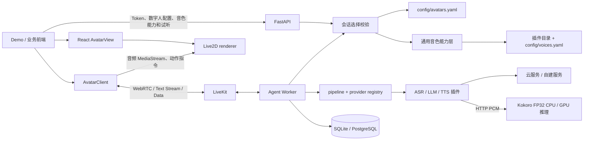

# 架构与扩展边界

`packages` 提供可复用 SDK，`apps/demo` 展示集成，`backend/avatarweave_agent` 负责应用编排，`backend/livekit/plugins` 提供模型供应商适配。单仓库不代表单进程；推理服务与 Agent 分别运行。

## 模块职责

| 模块 | 负责 | 不负责 |
| --- | --- | --- |
| `packages/core` | Room、转写、音频绑定、可信来源和动作协议 | Token 签发、模型加载、供应商选择 |
| `packages/renderer` | 模型资源、渲染、MotionSync、动作执行、销毁 | 账号、Agent 与 TTS 选择 |
| `packages/react` | React 生命周期和组件接口 | Demo 页面业务 |
| `avatarweave_agent/api.py` | HTTP、鉴权、签名 Token、公开配置、试听响应生命周期 | 厂商语音请求协议和固定模型动作 |
| `providers.py` | provider 支持的节点、类名、音色参数名、目录和本地服务声明 | HTTP 页面逻辑 |
| `voices.py` | 当前 TTS 能力、目录合并、选择校验、标准 LiveKit TTS 试听 | 各供应商底层协议 |
| `avatars.py` | 模型资源、默认数字人、语义动作映射 | 执行渲染 |
| `session_options.py` | 严格的单一会话 envelope 和选择校验 | 任意覆盖 provider 参数或密钥 |
| `pipeline.py` | 组合配置、参数检查、构建 LiveKit 会话 | 数字人模型、具体音色名称 |
| `worker.py` | 会话编排、动作工具、历史和消息事件 | 根据供应商名称写分支 |
| `livekit/plugins/*` | 厂商 API/协议与 LiveKit 接口转换 | 页面与产品数据库 |
| `kokoro_service.py` | FP32 模型、设备、推理锁与 PCM 输出 | LLM、用户权限、房间管理 |

## 配置边界

- `config/pipeline.yaml`：ASR/LLM/TTS 组合和轮次参数。
- `config/avatars.yaml`：数字人名称、资源 URL、动作映射，前端与后端共同读取。
- `config/voices.yaml`：各 provider 的可选音色和说明，可扩展插件内置目录。配置的默认音色会自动列出。
- `.env`：密钥、数据库、配置文件位置、本机 GPU 和运行服务开关；不通过公共 API 暴露。
- 各会话只能选择允许的 `avatar_id` 和 `tts_voice`，不能通过 metadata 注入任意构造参数或推理 URL。

音色选择通过 `avatarweave_session` metadata 传给对应 Agent；每个会话深拷贝 provider options，避免影响其他房间。业务自定义信息使用 envelope 的 `context` 字段。直接调用 LiveKit 调度的客户端和 Token API 使用同一套校验逻辑。

## 历史与存储

`get_messages(room, limit)` 先按时间及 ID 倒序限量查询，再将结果翻转为时间正序。Worker 使用 `AGENT_HISTORY_LIMIT`（默认 100，范围 1–2000）。不会先截取房间最早 500 条。当前仍是房间级历史，不宣称提供跨房间用户记忆、多租户隔离或数据库版本迁移。

## 推理和部署

Kokoro 插件调用 HTTP，推理服务可在另一个进程或机器上运行。`KOKORO_MANAGED=false` 禁用本机 sidecar，由调用方管理配置端点。`scripts/check-config.py` 输出当前配置需要的本地服务，启动器据此启动。

CPU 与 GPU 共用非量化 `kokoro-v1.0.onnx`。GPU 环境独立，使用机器已有 CUDA/cuDNN，不下载这些运行库；不允许 CUDA 初始化失败后悄悄回退 CPU。单实例当前按短句串行推理，多 GPU 调度和服务扩容仍需另外实现。

## 验证与维护

见 [维护约定](maintenance.md)、[协议](protocol.md)、[扩展指南](extending.md) 和 [验证记录](verification.md)。`scripts/config-schema.py --check` 检查公开配置 schema 与实际模型一致。
