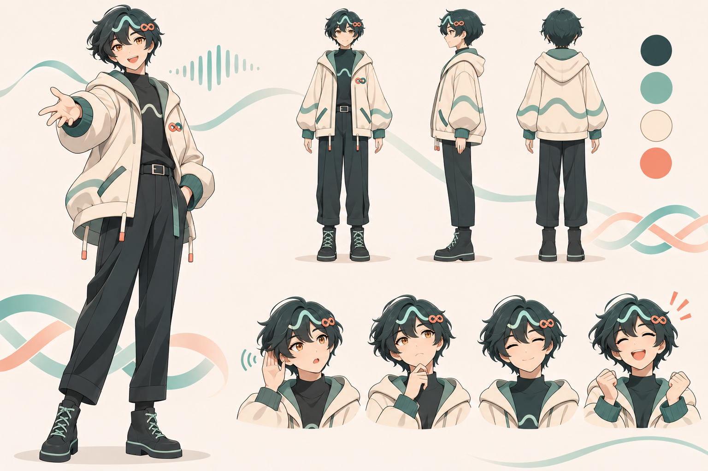

# AvatarWeave 织伴商业计划书

2026 年 11 月 5 日｜创始人决策与种子轮沟通稿｜产品工作名：织伴｜首发角色：小织

**一句话定位：一个能自然开口、记得共同经历、尊重记忆边界的卡通 AI 生活伙伴。**

AvatarWeave 已有实时语音、Live2D 表达与长期记忆的工程基础，下一步应验证成年人是否因“被准确记住、能继续聊下去”而持续使用并付费。建议先从中文成年人的晚间回顾与生活变化场景切入，以一个固定角色、有限免费体验和用量明确的订阅建立闭环。语音承担低门槛交互，卡通角色提供识别与表达，可信记忆支撑关系连续性。

当前处于工程原型及开发验证阶段。本文没有把用户规模、收入、融资或生产可靠性写成已有成绩；所有定价、市场容量、增长指标和预算均为拟议实验或情景假设。豆包指定链接未能读取，未将其内容作为依据，收到原文后可补充。代码依据包含当前工作区尚未提交的开发变更。

## 1 创业主张与投资逻辑

人们经常需要把一天的事说出来，但向朋友反复补充背景有负担，日记缺少回应，通用问答也未必能稳定接续个人经历。织伴提供一个可以随时开口的卡通伙伴：听用户说完，确认重要信息，在下次对话中自然接续，并允许用户决定什么被记住。

核心商业假设是：**关系的连续性可以创造独立于单次回答质量的订阅价值。** 这个假设需要通过长期留存和真实付款验证。仅有漂亮形象、调用大模型或保存聊天记录，都不足以证明它成立。

建议用三个证据逐步争取融资：第一，用户能在首次体验中理解产品；第二，跨日准确记忆能够提高自愿复访；第三，复访产生的收入能够覆盖语音和记忆的持续成本。先把一个成年用户场景做好，再评估多角色、其他终端和引擎授权。

## 2 如何使用语音超级入口这个定位

“语音是超级入口”可以作为长期愿景，但它描述的是交互方式，尚未回答用户为什么选择织伴。用户在公共空间不便说话，回看和纠正信息也更适合文字；因此首发应为语音优先、文字与可视记忆配合。

| 面向对象 | 建议表述 | 需要证明什么 |
| --- | --- | --- |
| 消费者 | 有些话，开口就好。小织陪你聊，也记得你在意的事。 | 好开口、接得上、记得准确 |
| 投资人 | 以语音为高频入口，以可信记忆构建持续关系的卡通 AI 伙伴 | 留存提升、付费理由、单位经济成立 |
| 长期战略 | 从个人生活陪伴，逐步成为理解个人上下文的语音入口 | 用户主动首选、跨场景复用、授权服务执行能力 |

“超级入口”成立至少需要用户在多种真实情境主动首先打开产品，以及对后续服务的明确授权。现有代码主要支撑交流、记忆和角色表达，不能据此宣称已具备广泛的跨应用执行能力。近期路线不扩张为购物、金融或医疗代理。

## 3 首发用户与核心需求

首发假设人群为 **22—35 岁、愿意与卡通角色交流、近期经历工作或生活变化的中文成年人**。以需求筛选，不预先限制性别。先服务“每天有些事想说，也希望下次不用重讲背景”的用户，再验证其他年龄和家庭场景。

| 场景 | 用户的问题 | 织伴交付 | 验证信号 |
| --- | --- | --- | --- |
| 下班后的五至十分钟 | 脑中事情很多，不知道从哪里讲起 | 自然倾听、梳理重点、可选记录一件事 | 用户主动开始第二次交流 |
| 面试、搬家、换工作 | 每次都要重复人物与背景 | 准确接续已授权的经历与变化 | 用户确认接续有帮助 |
| 生活里的小进展 | 小事值得分享，但不总方便打扰别人 | 温和回应、记录共同经历 | 一周内在不同日期自愿回访 |
| 查看与纠正记忆 | 担心 AI 乱记或无法删除 | 显示来源，纠正、忘记、导出 | 能独立完成控制操作 |

不以治疗、危机干预或替代现实关系为产品价值承诺。角色可以陪伴倾诉，但不自动诊断。遇到明显危机场景，应采用审定的回应与真人支持路径。首发招募、体验及付费面向成年人。

早期访谈安排 30 人，每人围绕最近一次真实经历展开，至少覆盖独居、合住、生活过渡三类情境。询问现有替代方案、愿意说话的空间、何时觉得被打扰，并在体验后测试真实付款意向。避免只问“你喜欢 AI 陪伴吗”。

## 4 产品体验与最小商业版本

首次体验允许临时对话。用户愿意保存长期记忆时，再完成可恢复账号登录和清晰授权。默认一个角色，先减少选择负担；不会以频繁换角色替代持续关系。

一段用于演示的合成故事：用户说“我下周三面试，有点紧张”，小织先回应当下，再询问是否需要记住和后续跟进。用户允许后，可在记忆页看见事项。下次见面，小织先回应当前问题，在约定条件满足时问“上次说的面试，你愿意聊聊后来怎么样了吗？”；如果用户说延期，就更新事项，避免按旧时间继续追问。

产品闭环为：**开口 → 被回应 → 确认值得记住的事 → 跨日自然接续 → 查看或纠正 → 再次交流**。增长来自体验价值，跟进由用户许可控制。

| 页面或能力 | 首发交付 | 主要指标 |
| --- | --- | --- |
| 首次见面 | 角色介绍、AI 身份、声音试听、麦克风检查 | 首次有效对话完成率 |
| 陪伴对话 | 语音、字幕、打断、静音、文本备用 | 首个实质音频延迟、失败率 |
| 我们记得的事 | 人物、偏好、事件、来源及处理状态 | 纠错成功率、误记报告率 |
| 生活时间线 | 展示已授权的重要经历与阶段 | 用户确认有用的回顾比例 |
| 记忆控制 | 临时模式、许可、纠正、删除及导出 | 用户能否理解控制后果 |
| 订阅与额度 | 套餐、余量、订单、恢复权益、售后 | 试用转付费、退款、成本 |

支付、权益、商业分析及正式运营仍需建设。初期不同时上线角色商城、硬件、儿童版、歌舞内容生态或口语课程。仓库较早的口语方案作为可复用的独立探索保留；本计划以指定的长期生活陪伴方案为准。

## 5 现有实现与交付边界

设计主文档仍标注“未启动实现”，但 11 月 5 日开发记录和工作区代码已向前推进。判断现状时，应结合实现文件与开发验证记录；开发环境通过不等于生产验收。

| 能力 | 当前依据 | 商业意义与边界 |
| --- | --- | --- |
| 实时语音与多供应商配置 | `worker.py`、`config/pipeline.yaml`、LiveKit 插件 | 可组合 ASR、LLM、TTS；需在目标网络和设备测体验及成本 |
| 卡通角色表达 | `packages/renderer/src/index.ts`、`config/avatars.yaml` | Live2D 渲染、口型、触摸与动作基础；当前默认角色为 Kei，新角色尚未绑定 |
| 身份与私人会话 | `memory/identity.py`、`rtc_session.py` | 账号隔离、连接恢复；正式账号恢复和运维仍需验收 |
| 来源与事实版本 | `memory/facts.py`、`storage.py`、`lifecycle.py` | 为纠正和历史变化提供依据，需评估真实表达中的准确率 |
| 有界记忆检索 | `memory/recall.py`、`context.py` | 词法、实体、时间、向量检索；未验证十年规模性能 |
| 记忆控制与前端 | `MemoryPanel.tsx`、`memory/controls.py`、`privacy.py` | 纠正、删除、来源、偏好与跟进；物理删除依赖真实备份清理 |
| 后台维护及携带 | `memory/jobs.py`、`maintenance.py`、`portability.py` | 摘要、分层、归档、导入导出；单包各类最多 1000 对象、明文最多 8 MiB |
| 商业运营 | 当前证据未证明完整闭环 | 订阅、支付、客服、监控、成本台账与持续留存验证列为新增工作 |

开发记录报告过 SQLite、PostgreSQL、前端以及真实 HTTPS/RTC 的验证；本计划引用的是仓库记录，没有重新运行这些业务验收。现有证据不支撑“永远不会忘”“十年已验证”或“已服务大规模付费用户”。生产前还需完成规划中的容量清单、至少 1000 个独立保留测试案例、设备播放与灰度验证等关口。[工程依据](../voice-memory-development/tasks.md)

## 6 Tolan 的公开路径与我们的选择

Portola 创始人于 2025 年 2 月介绍 Tolan 时，将它定位为有形象、可自然交流并积累共同记忆的伙伴，目标是帮助用户应对生活中的不堪重负。其公开长期方向是基于共同引擎，服务不同人生阶段。这属于公开产品愿景，并非获得了其内部商业计划。[创始人介绍](https://www.tolans.com/relay/introducing-tolan)

2026 年 11 月 5 日读取的官网自述有 25 万以上活跃用户、过去一年超过 7000 万次对话及超过 6000 万美元资本支持；官网未在该处完整界定活跃口径。2026 年 10 月 19 日报道将约 25 万表述为月度用户，并披露新增 3000 万美元融资。这些是公司披露或媒体报道，不能当作审计数据，也不能与历史“创建过角色的人数”混用。[Tolan 官网](https://www.tolans.com/) · [2026 年融资报道](https://www.upstartsmedia.com/p/tolan-raises-30m-for-ai-companion-you-trust)

2025 年早期资料主要描述年轻女性；2026 年报道则描述更多 30—45 岁及家庭照护用户。这提示陪伴需求会随产品变化，不能把早期画像直接套用到中国首发市场。该报道的收入描述也不足以计算其利润率或精确付费转化率。[2026 年报道](https://www.upstartsmedia.com/p/tolan-raises-30m-for-ai-companion-you-trust)

创始人访谈强调语音质量、低延迟和记忆投入，也提到早期长时间使用带来成本压力、推动付费建设。织伴应借鉴“体验与成本同时验证”的方法，不复制未核实的套餐或推算对方单位经济。[创始人访谈](https://subclub.com/episode/fueling-growth-with-ai-and-viral-product-features-ajay-mehta-portola)

| 可借鉴的方向 | 织伴的落地选择 | 需要避免的推论 |
| --- | --- | --- |
| 角色帮助建立交流关系 | 一个有稳定表达风格的卡通人物 | 卡通形象自然保证留存 |
| 语音与记忆共同塑造体验 | 每轮延迟、记忆准确率和跨日接续一起测 | 只要换更强模型就解决全部问题 |
| 从具体人群扩到人生阶段 | 先验证晚间回顾，再评估生活事件场景 | 首发覆盖所有年龄与用途 |
| 共同引擎支持未来产品 | 保留 SDK 模块化，商业上先聚焦消费者 | 现在同时做消费产品与外包平台 |

Tolan 的角色设计文章解释了从可爱宠物感向同伴感调整的过程。织伴采用成年感卡通人物，吸收其“角色关系要匹配用户期望”的经验，保持自己的视觉语言。[Tolan 角色设计](https://www.tolans.com/relay/designing-tolan-part-1-characters)

## 7 替代方案与竞争优势假设

| 用户当前选择 | 主要吸引力 | 织伴要验证的优势 |
| --- | --- | --- |
| 通用 AI 助手 | 能力广、进入方便 | 生活背景接续更自然，角色表达更一致 |
| 角色聊天与虚拟陪伴 | 角色丰富、故事互动 | 真实生活事实可追溯、可纠正且可带走 |
| 日记与记录工具 | 自主记录、便于回看 | 开口记录更轻松，能得到回应 |
| 朋友与家人 | 真实互惠关系 | 补充不方便即时交流的时刻，并帮助回到现实生活 |

“可信记忆”是拟建立的优势，不能据公开材料缺失就宣称其他产品没有。技术实现本身可被追赶，较长久的竞争力需要来自持续评测、真实纠错经验、稳定角色 IP、口碑和服务可靠性。用户记忆的迁移能力提升信任，商业留存应靠价值，不靠无法导出。

## 8 市场进入与容量估算

本轮不使用未经核验的行业总规模。以能触达、能激活、愿付费的漏斗决定预算。下表是一个首年可执行的假设模型，不是市场调查结果；独立触达需要去重，付费转化须排除退款。

| 首年漏斗假设 | 数量或比例 | 结果 |
| --- | --- | --- |
| 内容与社群可归因独立触达 | 1,000,000 人 | 1,000,000 |
| 进入体验页 | 5% | 50,000 |
| 完成首次有效对话 | 40% | 20,000 |
| 30 天内首次付款 | 8% | 1,600 名累计新增付费用户 |

累计新增付费用户不等于年末订阅用户，更不能直接乘 12 当年收入。若均匀每月新增约 133.3 人、月流失 8%、从零开始，按当月新增计完整订阅月的简化口径，年末约 1,054 名在订用户，全年约 7,880 个付费用户月；按每月 59 元计算约 46.49 万元流水，尚未扣成本。实际预测应按月记录获客时间、续费和退款。

一个规模参照：10 万名持续付费用户 × 每月 59 元 × 12 个月 = 7080 万元年化流水。它是规模目标的算术，不代表可服务市场，也不是项目预测。获得早期真实数据后，再估算可服务市场和长期空间。

## 9 定价实验与单位经济

建议测试七日体验、最多 30 分钟；标准订阅假设为每月 59 元、含 300 分钟，高用量订阅假设为每月 99 元、含 600 分钟。超额包暂以 100 分钟 19 元进行测试。套餐分钟按实际连接且可对话时长计量，断连和系统故障应扣除或补偿，付款前展示完整规则。先不推低价终身会员。

记忆查看、纠正、删除和合法导出不作为付费解锁点。退订后保留策略需要在购买前明确；不把十年保存当作无条件承诺。是否给高价档更丰富的角色表达，待核心付费理由清楚后再决定。

基准模型仅分析 59 元标准档，单用户每月使用 180 分钟。假设每分钟综合变动成本 0.08 元，包含 ASR、主模型、TTS、RTC 和随使用增长的后台抽取；每用户每月另计 3 元数据库、存储、维护及变动支持。基础闲置算力和固定人力放入固定开支，避免重复或遗漏。该成本需用实际账单替换，不是供应商报价。

| 每付费用户月 | 计算 | 金额 |
| --- | --- | --- |
| 收入 | 标准档 | 59.00 元 |
| 渠道与退款准备 | 收入的 5%，实验假设 | 2.95 元 |
| 使用成本 | 180 × 0.08 | 14.40 元 |
| 记忆与变动支持 | 假设 | 3.00 元 |
| 单位贡献 | 59 − 2.95 − 14.40 − 3 | 38.65 元 |
| 单位贡献率 | 38.65 ÷ 59 | 65.5% |

单位贡献不是净利润，尚未承担免费体验、营销、工资、租赁、税费等。若月流失 8%、贡献稳定，简化贡献 LTV 约为 38.65 ÷ 8% = 483.13 元；该公式只适合稳定队列近似，不是收入保证。以付费获客成本 100 元为假设，不计免费体验的回收约 2.59 个月。30 分钟体验若全部用满、激活转付费 8%，每获得一名付费用户还需摊约 30 元体验成本，则合计 130 元、回收约 3.36 个月。实际摊销以账单和同期转化为准。

成本敏感性：每月 300 分钟全用满、每分钟 0.08 元时，标准档单位贡献为 29.05 元；若成本涨至 0.16 元，则只剩 5.05 元。若渠道与退款合计从 5% 上升到 30%，180 分钟基准贡献降为 23.90 元。必须同时测使用分布、成本尾部和渠道，不能只展示平均毛利。

## 10 三种经营情景与资金计划

以下是**稳定月份情景**，不表示首年收入。固定开支假设每月 15 万元，包含小团队人力、基础算力、工具、日常行政与内容维护；另列营销和免费体验预算，每月流失假设 8%。三种情景共享前述标准档单位贡献，规模扩大后需重新估计人员和基础设施。

| 月度指标 | 保守 | 基准 | 增长 |
| --- | --- | --- | --- |
| 活跃用户假设 | 10,000 | 50,000 | 150,000 |
| 付费用户 | 300 | 2,500 | 10,000 |
| 付费占活跃比例 | 3% | 5% | 6.67% |
| 订阅流水 | 17,700 | 147,500 | 590,000 |
| 付费用户贡献 | 11,595 | 96,625 | 386,500 |
| 固定开支 | 150,000 | 150,000 | 150,000 |
| 营销预算 | 10,000 | 40,000 | 120,000 |
| 免费体验与服务预算 | 5,000 | 20,000 | 50,000 |
| 月经营结余估算 | −153,405 | −113,375 | 66,500 |

以上均为人民币，结余未计税及一次性支出。按获客成本 100 元，营销预算分别对应 100、400、1200 名新增付费用户；按 8% 流失，维持规模分别需补充 24、200、800 人。这只是预算一致性检查，不能保证渠道可以持续交付。免费预算耗尽前应限制新试用或优化流程，不能静默扩大亏损。

维持每月 15 万固定开支、4 万营销及 2 万免费预算时，盈亏平衡约需 210,000 ÷ 38.65 = **5,434 名付费用户**。若成本或获客渠道变化，必须重算。

拟议种子资金为 **300 万元人民币**，不设未经创始人确认的估值与出让比例：产品与工程 150 万，角色与内容 30 万，算力与真实评测 35 万，增长实验 35 万，隐私与运营支持 20 万，预备金 30 万。属于资金用途预算，与月度经营表是不同视角，不能相加为总成本。按每月全口径净现金消耗 20 万估算，提供约 15 个月窗口；实际可支撑时间由招聘、收入、采购与税费决定。

前 90 天支出建议上限 45 万元，阶段未达门槛不扩团队和广告。对外融资前补齐真实创始团队履历、主体与股权、历史投入、现金余额、商标及角色/音色/模型授权、用户与财务台账。本文不虚构这些尚未提供的信息。

## 11 获客与验证计划

获客内容围绕“第二次它还能接上你的故事”做真实演示。使用合成经历展示记忆与纠错；真实用户故事必须单独取得发布许可。首轮渠道选择小红书、短视频及小规模兴趣社群，均为待测试渠道。渠道预算每周以激活、复访、付费和退款复盘，不以播放量代替经营结果。

北极星指标设为“每周有价值陪伴用户数”：一周内至少两天主动完成有效交流，且至少一次自愿反馈认为有帮助的去重成年用户。反馈采取轻量抽样，同时报告未反馈率。有效交流定义为累计五分钟或至少三个有效来回，剔除测试、错误及空连接；时长不作为唯一优化目标。

| 阶段 | 工作与规模 | 继续投入门槛，均为拟议目标 |
| --- | --- | --- |
| 第 1—30 天 | 30 人访谈、50 人邀请测试、完善角色与事件埋点 | 找到明确复访理由；激活率至少 60%；严重隔离/删除缺陷清零 |
| 第 31—60 天 | 累计 150 名激活用户，跑满可比较的跨日观察 | 激活用户 D7 留存至少 30%；记忆有效性可盲评；失败和退款原因可追踪 |
| 第 61—90 天 | 累计 300 名激活用户，真实订阅试验 | 成熟队列 D30 至少 15%；30 天付费转化至少 8%；成本有正贡献 |
| 第 4—6 月 | 复测两至三个队列，逐步扩到千人量级 | 单位贡献率至少 60%；含试用获客回收不超过 4 个月；客服与可靠性可承受 |
| 第 7—12 月 | 满足前置门槛才扩大渠道和团队 | 保持留存与成本，评估第二场景或角色；规模按现金流决定 |

D7、D30 分别按激活日后第 7、30 个自然日是否返回定义，同时另报七日/三十日窗口回访；只统计观察期完整的队列，报告样本量与区间。300 人在 8% 转化下仅约 24 名付费用户，结论只能用于早期判断。

关键对照试验是在知情同意下比较普通会话与跨日记忆体验，保持角色、模型及招募渠道一致。先用小样本观察误记和访谈，再根据基线与希望识别的最小提升确定正式样本量。若用户主要为颜值付费但跨日接续无增益，应重审记忆投入；若两轮迭代仍达不到留存门槛，先收窄场景再扩大营销。

## 12 工程路线与经营风险

| 风险 | 商业影响 | 下一阶段动作 |
| --- | --- | --- |
| 错记、串人物或删除后再次出现 | 信任流失与退款 | 关键案例回归、来源展示、纠正与删除贯通验证 |
| 语音延迟、打断失效或掉线 | 首次体验失败 | 在目标手机与网络测端到端 P50/P95 和失败率 |
| 长期成本随历史增长 | 订阅贡献下降 | 追踪每用户分钟、token、存储和维护成本，做长历史回放 |
| 免费使用与重度用户成本偏高 | 现金消耗扩大 | 明确额度、分档、超额提示，保留服务补偿规则 |
| 人物引发过度恋爱或依赖预期 | 品牌定位偏离 | 成年同伴表达、现实生活支持、用户控制跟进和通知 |
| 隐私与内容运营准备不足 | 上线与渠道风险 | 上线地区确定后审核当地适用要求、供应商数据流及授权材料 |
| 上游模型升级、音色或形象授权变化 | 人格与体验中断 | 版本回归、替代供应商、合法资产及用户告知流程 |

工程顺序建议：首先补齐生产身份、备份恢复和删除验证；其次建立真实成本与端到端质量看板；然后完成支付、权益及售后闭环；最后逐步扩大流量。规划中的普通记忆准备 P95 不超过 200ms 等指标属于目标，不能作为现有生产 SLA。[验收与实现规划](../voice-memory-implementation-plan.md)

“十年以上”用于架构的耐久性目标：数据可迁移、重要事实有来源、模型升级保留连续性、服务故障可恢复。对用户可承诺明确的保留政策和可兑现的服务范围，不承诺已验证十年陪伴或永久经营。

## 13 专属人物设计

角色工作名 **小织**，品牌工作名 **织伴**，与 AvatarWeave 的“编织”概念呼应。它是为本项目定制的卡通 AI 同伴，不是基于创始人照片的肖像。采用偏中性的年轻成年人形象、墨青短发、薄荷色声波发束、珊瑚色编织结与奶油色外套，连接声音、共同经历和温暖感。名称与图形仍需在正式商业使用前完成检索及权利确认。

小织的性格是温暖、有好奇心、讲具体事实、允许沉默。说话简短、自然，不刻意卖萌；不以讨好代替诚实，也不声称有人的身体和真实经历。建议邀请成年男女用户分别测试角色亲和力、是否愿意长期交流及对关系类型的预期。

| 情境 | 示例表达 |
| --- | --- |
| 初次见面 | “我是小织。今天想随便聊聊，还是有一件事想慢慢说？” |
| 记忆不确定 | “我记得你提过这件事，但时间我不太确定，你愿意帮我确认一下吗？” |
| 用户纠正 | “谢谢你告诉我。更正保存后，我会按新的情况理解。” |
| 用户离开 | “好，先去忙你的。下次想聊的时候再来。” |

图中包含主立绘、正侧背视图及倾听、思考、微笑、庆祝四种表情，可作为插画与建模沟通底稿。正式 Live2D 制作还需整理分层 PSD、五官和头发遮挡补全、眼口参数、呼吸与动作、Cubism 导出及运行验证。当前交付为概念图，不能直接替换 `model3.json`；生产默认角色未变更。

## 14 路演与演示安排

建议 10 页路演顺序：用户的具体时刻；一句话产品；首次与第二次体验；语音和可信记忆；现有工程证据；Tolan 公开路径及差异假设；首发市场漏斗；定价与成本；90 天门槛；团队与资金用途。团队页待真实信息补齐后再发送给投资人。

三分钟演示使用合成用户：30 秒介绍角色和许可，60 秒讲一个生活事件并展示保存状态，45 秒在新会话接续，30 秒纠正并展示来源，15 秒说明套餐实验和下一步。只有后台已确认才能说“已保存”；没有端到端成功时，应展示真实处理中状态。

结尾融资表达建议：“我们已建立语音、卡通表达和可控记忆的工程基础，计划用下一阶段资金验证成年人是否愿意为持续、可信的生活陪伴付费。我们以留存、记忆质量和单位贡献作为扩大投入的条件。”

## 15 资料与交付索引

本地依据：[长期陪伴规划](../voice-memory-implementation-plan.md)、[开发任务与证据](../voice-memory-development/tasks.md)、[运行边界](../voice-memory-development/runtime.md)、[早期口语方向](../product-plan.md)、[项目说明](../../README.zh-CN.md)。源代码文件位于上表所列仓库路径。

公开资料均于 2026 年 11 月 5 日查阅，正文对应链接支持各自陈述。Tolan 的战略归纳仅基于公开创始人文章、访谈、官网与媒体报道，没有获得内部计划书。豆包来源 [指定讨论链接](https://www.doubao.com/thread/x9ry6WpdtnaCsMxl6) 本次不可访问，待用户提供原文后合并。

交付包括本正文、同内容排版 HTML/PDF、财务情景 CSV、人物 PNG 和最终生成提示词。财务 CSV 用于修改假设与复核，不含真实经营数据。人物由内置 image_gen 生成，原始提示词见 [image-prompt.txt](assets/image-prompt.txt)。
