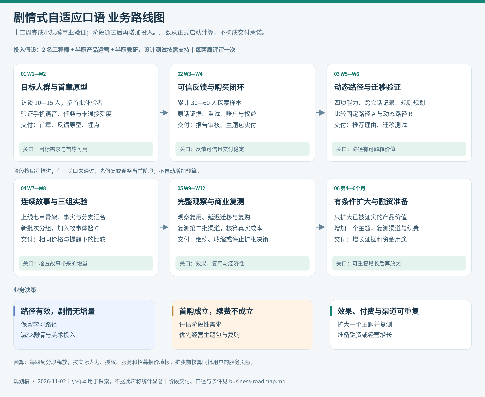
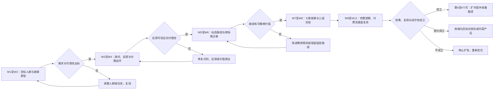
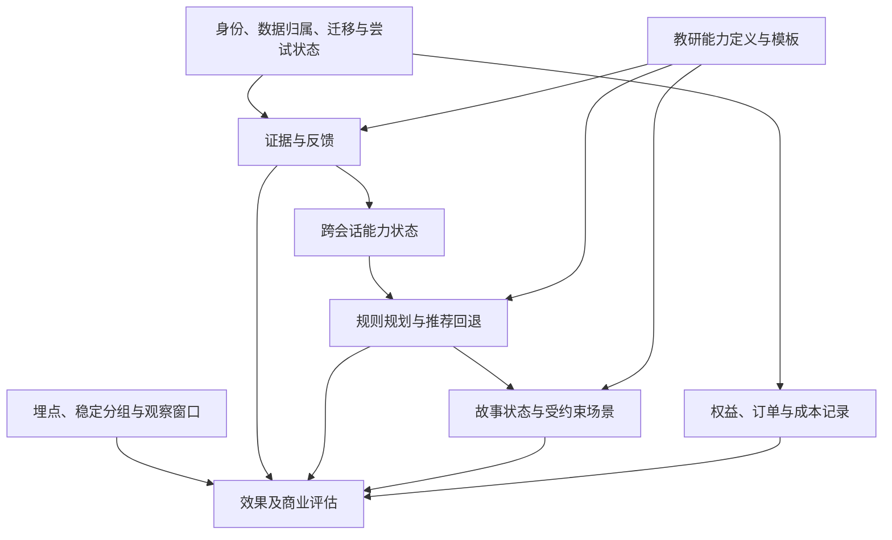

# 剧情式自适应口语业务路线图

版本日期：2026 年 11 月 2 日。配套设计见 [完整产品方案](product-plan.md)。W1 表示项目正式启动的第一周，以下为相对排期，不代表已经承诺的日历交付时间。

先用首章验证任务价值，再用动态路径验证学习效果，最后检验连续剧情对留存与付费的增量。十二周的目标是完成小规模商业验证和下一步投入决策；后续扩张取决于证据，不按日期自动启动。

## 1 业务路线总图



[查看可编辑的 SVG 路线图](assets/business-roadmap.svg)。下方保留 Mermaid 路线源码，便于调整排期和阶段条件。



## 2 阶段计划与交付

排期假设：两名全栈或前后端工程师、一名约半职产品兼运营、一名约半职英语教研，以及按需设计和测试支持。若只有一名工程师，优先保留首章、证据、路径与手动运营，延后付费自动化、精美地图和完整故事；不要在同一时间承诺全部功能。外部招募、支付接入和服务资质可能延长日历时间。

| 阶段 | 核心问题 | 产品与工程交付 | 业务动作 | 负责人角色 |
| --- | --- | --- | --- | --- |
| W1 至 W2 | 谁需要，能否顺利完成首练 | 首章、任务卡、反馈原型、首轮语音基线、临时身份与最小埋点 | 访谈 10 至 15 人，招募首批 15 至 20 人；验证渠道和卡通接受度 | 产品主责，工程与教研配合 |
| W3 至 W4 | 反馈有用吗，是否愿意付钱 | 证据引用、重试、账户保存、服务端权益、受控商品与订单流程、异步任务 | 形成累计 30 至 60 人探索样本，测试主题包，审核至少 50 份报告 | 工程主责，产品负责定价和售后，教研审核 |
| W5 至 W6 | 下一步练习是否更合适 | 四项能力状态、跨会话记录、规则规划、推荐理由、迁移测试、固定及动态路径 | 运行 A 与 B 的探索比较，访谈拒绝推荐者，观察延迟迁移 | 教研与工程主责，产品分析 |
| W7 至 W8 | 故事是否产生额外价值 | 七章骨架、故事快照、局部事件、分支汇合、C 组、故事与直接模式切换 | 招募新批次随机分组，冻结主指标、价格和提醒策略 | 产品主责，教研与设计负责故事质量 |
| W9 至 W12 | 用户是否持续使用并形成收入 | 修复主要失败原因、成本面板、复购或续费记录、版本与实验导出 | 完成观察窗口，测试第二批渠道，决定是否扩招正式实验和增加投入 | 项目负责人组织评审 |
| 第 4 至 6 个月 | 是否可以重复增长 | 按证据扩一个主题，完善支付与运维，必要时建设内容管理 | 复测获客经济性，选择融资或经营增长 | 项目负责人，工程、增长与教研 |

探索阶段可用明确条款的受控支付或人工收款对账，权益由服务端录入并留审计记录。扩大到公开销售前，补齐自动验签回调、退款、对账与客服。不能把付款截图或客户端状态当作自动发权益的依据。

## 3 工程依赖与关键路径



语音稳定性、身份隔离、证据可信和状态幂等先于复杂剧情。规划器依赖可信证据；先实现规划器再补证据，会使后续无法判断推荐是否正确。

工程分工建议：工程 A 负责业务 API、数据、评估与任务执行；工程 B 负责移动前端、实时接入、任务 UI 与可观测性。产品负责用户和商业实验，教研负责能力、模板、反馈抽查和迁移测验。每周联合复盘失败样本，避免只看汇总曲线。

## 4 阶段继续投入条件

以下数字是首轮内部决策起点，不是行业标准、融资门槛或统计显著性条件。小样本必须报告人数、分母、观察窗口和退出原因，不能只报告百分比。门槛在招募前冻结，调整需留理由。

| 关口 | 继续条件 | 未达到时的动作 |
| --- | --- | --- |
| G0 首章可用 | 首批至少 15 位目标用户中，至少 12 位能在无人工接管下完成核心任务；访谈能找到近期真实使用经历与现有替代办法 | 优先修复任务、入口和语音问题，必要时缩小人群 |
| G1 反馈可信 | 达到产品方案中的稳定性与反馈抽查要求；出现多位非亲友用户真实购买，且买因与产品价值有关 | 反馈不可信先修复；无购买时检查人群、交付、价格和付费曝光 |
| G2 路径可用 | 推荐满足目标、难度和前置约束；探索样本中能观察到按建议练习及迁移的具体证据，未出现明显体验伤害 | 规则与教研复盘，必要时用固定路径继续经营，暂缓复杂剧情 |
| G3 商业复测 | 至少两批目标用户产生主动复用与购买；掌握完整的七日及后续观察窗口；可重复渠道和单位成本有记录 | 按下方决策矩阵收缩或调整，不直接放大买量 |

G2 的方向性结果用于决定是否值得做更严格的试验。若需声称动态路径优于固定路径，或故事提高留存，必须按照预先定义的主指标、最小有意义差异和样本量进行验证。不能把少数成功案例当作因果证据。

## 5 招募与渠道路线

### 5.1 第一阶段招募

优先寻找有明确时间节点的人，例如三个月内出境、正在准备留学、曾在真实口语场景卡住的成年人。招募信息展示「五分钟体验及能完成的任务」，不要主要用数字人技术吸引不相关人群。

候选渠道包括出境准备社群、留学服务合作方、成人英语学习社区，以及讲述真实交流困难的短内容。实际投放或联系合作方需由项目负责人确认账号、预算和授权；本文仅安排渠道实验。

每个渠道分别记录触达、有效访问、目标用户占比、激活、完整观察窗后的复用、净付费与获客支出。亲友、奖励测试者与自然用户分开标记。研究激励不与好评或购买绑定。

### 5.2 扩大前的渠道验证

先比较两至三个小规模渠道，不先建设庞大内容矩阵。找到一个能持续带来目标用户的渠道后，再进行第二批复测；渠道容量、用户质量和成本同时评估。

如果用户主要因剧情兴趣而来，保留这一发现，但应重新测试其实际学习需求和购买原因，避免将娱乐用户误当作教育需求成立。

## 6 商品与收入路线

| 阶段 | 商品假设 | 要验证的事情 |
| --- | --- | --- |
| 首轮 | 一章完整免费体验，七章主题包暂以 19.9 至 39.9 元区间设计不同批次实验 | 能否为明确交付付费，购买后是否实际使用 |
| 第二轮 | 新主题包或进阶包 | 是否愿意第二次购买，不能只依赖第一次新鲜感 |
| 持续价值成立后 | 月订阅暂以 39 至 69 元区间探索 | 用户是否需要持续路径、是否愿意到期续费 |
| 有组织需求后 | 标准化团体试点 | 是否有人愿为团队训练采购，是否能避免大量定制 |

以上价格均为实验假设，不是市场调查得到的价格结论。一次实验中统一标价、权益与交付，价格试验使用不同且可追踪的批次，避免干扰路径和剧情的效果比较。订阅不默认承诺无限用量；根据实测服务成本定义合理权益。

第一笔收入、可重复复购、可持续订阅分别代表不同证据。出境需求可能是阶段性的，主题包成立时不必强行改成订阅。

## 7 单位经济与预算

### 7.1 必须记录的成本

| 类别 | 计算方式 |
| --- | --- |
| ASR 与 TTS | 按实际秒数、字符或供应商账单分摊到尝试 |
| 对话模型 | 对话输入输出及缓存实际消耗 |
| 评估与规划 | 每次结束、失败重试、计划生成的实际消耗 |
| 实时与基础设施 | 媒体传输、计算、数据库、存储的相关变动成本 |
| 直接服务 | 支付手续费、退款损失、按次支持和人工交付 |
| 获客 | 渠道支出及直接投放制作成本；研究招募成本单列 |
| 固定投入 | 工程、产品、教研、设计、版权和固定基础设施 |

```text
净收入 = 实收金额 - 退款 - 收入相关税费
服务贡献 = 净收入 - 模型与语音成本 - 变动基础设施 - 支付及直接服务成本
服务贡献率 = 服务贡献 / 净收入
付费获客成本 = 渠道获客支出 / 归因到该渠道的新增净付费人数
观察期贡献回报 = 同批用户观察期累计服务贡献 / 该批获客支出
经营结果 = 服务贡献 - 获客支出 - 固定投入
```

长期价值暂用已发生的批次累计贡献，不以未经验证的长续费周期外推。回本周期用同一批用户累计贡献覆盖获客支出的时间衡量；尚未回本就如实标记未回本。

### 7.2 预算控制方式

启动前填入角色实际人力费用、素材授权报价、服务单价和招募预算，形成十二周现金计划。W1 至 W4、W5 至 W8、W9 至 W12 分三段释放，每两周回看；不因写入路线图而自动授权支出。

配置试用限额、单次练习预算、最大重试数、每日异常消耗告警与账户限流。达到阶段预算上限先停止扩招和付费投放，保留已购用户应有交付，复盘后决定下一步。

## 8 业务决策矩阵

| 观察结果 | 优先行动 |
| --- | --- |
| 首练失败多，评价两极分化 | 先修复语音、识别、任务和反馈，不扩大内容量 |
| 动态路径改善迁移，剧情没有增加复用 | 保留动态路径，简化剧情与美术投入 |
| 剧情促进复用，学习迁移没有改善 | 改进教学；若转向内容产品，重新验证购买理由和市场定位 |
| 有首购，没有复购或续费 | 评估需求是否阶段性，优先经营主题包与获取下一批用户 |
| 用户持续使用，但服务贡献很低 | 优化异步推理、权益和定价；在账算清前不放大获客 |
| 个别企业愿付钱，但要求大量定制 | 单独核算项目交付与维护成本，不用项目收入证明标准产品成立 |
| 多批用户复用、迁移、购买和渠道均可重复 | 增加一个主题，复测后扩大增长或启动融资 |

## 9 融资路线

融资与业务验证并行准备，但不把融资到账作为验证用户需求的前置条件。

| 阶段 | 可准备的材料 | 适合讨论的内容 |
| --- | --- | --- |
| W1 至 W4 | 清晰人群、可体验首章、团队背景、访谈与实际购买 | 需求假设、团队执行、早期方向 |
| W5 至 W8 | 证据化反馈、路径机制、错误样本、初步迁移评估 | 为什么产品可能产生更好结果 |
| W9 至 W12 | 分批留存、净收入、成本、完整观察窗口、渠道复测 | 是否值得扩大验证与投入 |
| 后续 | 更充分的对照实验、真实续费、重复渠道、内容生产效率 | 增长资金用途和规模化条件 |

材料至少包含：问题与目标人群、三分钟演示、与 Praktika 等竞品的具体差异、实际批次指标、学习评估方法、服务贡献、获客来源、团队分工、未来十二个月资金用途与里程碑。缺失数据明确留空，不把访问量当付费用户，不把首购当续费。

公开历史案例说明语言学习赛道存在融资活动：Speak 于 2024 年 12 月宣布 7800 万美元 C 轮；Blossom 披露领投 Praktika 的 3550 万美元 A 轮。这些交易不构成本项目的估值或可融资性依据。[Speak 公告](https://www.speak.com/blog/series-c)、[Blossom 投资组合](https://www.blossomcap.com/portfolio)

## 10 启动清单与评审节奏

第一周完成以下决策并建立对应工作项：

1. 确认首发人群、用户所在市场、可触达渠道及产品负责人。
2. 确认两名工程师与教研可投入时间，录入实际预算和每阶段上限。
3. 选定七章中的首章与四项能力，完成任务成功条件和反馈审核准则。
4. 复测手机真实语音，得到延迟、识别错误和服务成本基线。
5. 确认角色、美术、音色和 Live2D 的具体使用授权与发行适用条件。
6. 建立用户身份、数据保留和删除流程，明确试用与购买条款责任人。
7. 冻结首轮指标、分组规则、观察窗口和招募计划。
8. 招募并预约首批五位目标用户，观察完整体验后再扩大招募。

每周查看漏斗、失败样本、反馈争议和成本；每两周进行一次关口评审，记录继续、修复、收缩或暂停扩张的决定及依据。第十二周交付一份基于完整观察窗口的业务复盘，并明确下一阶段只扩大哪一项投入。
