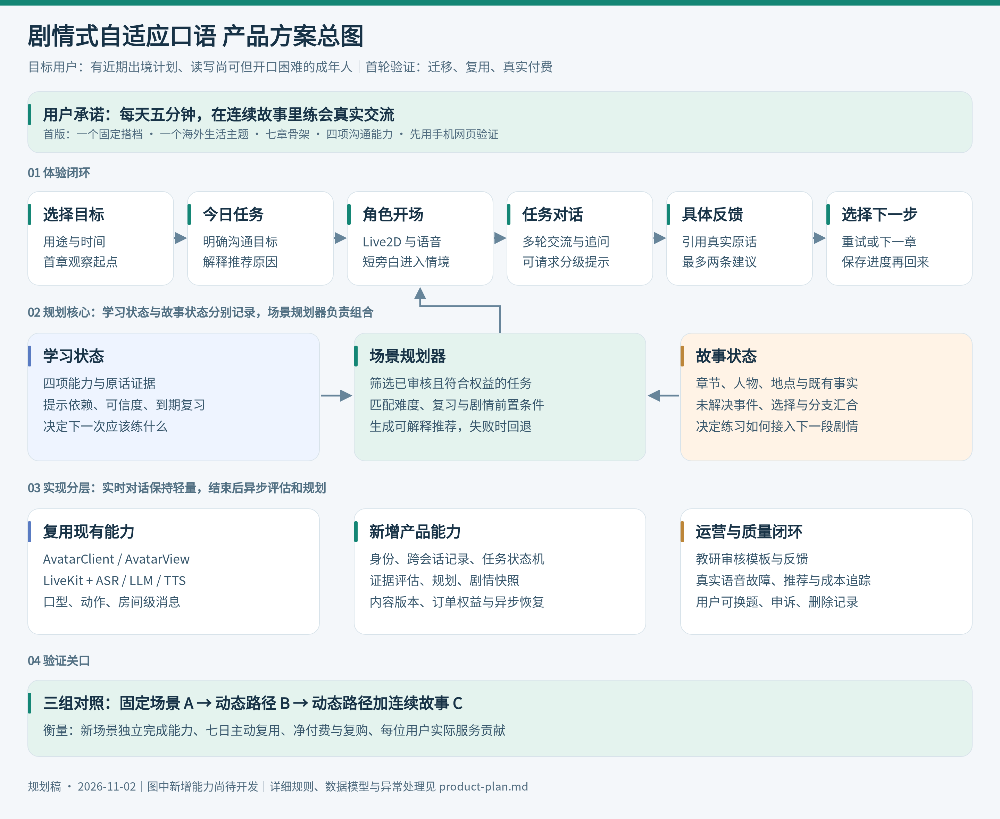
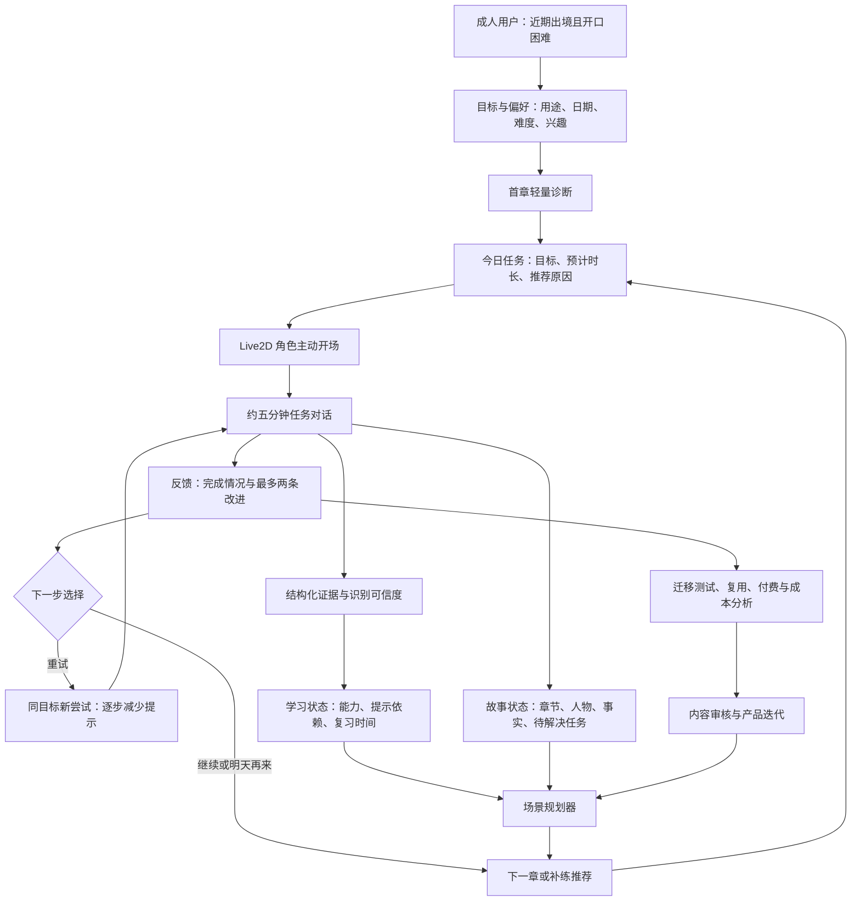
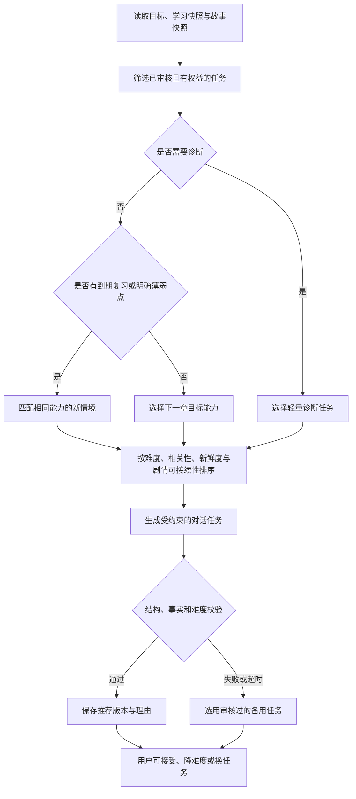
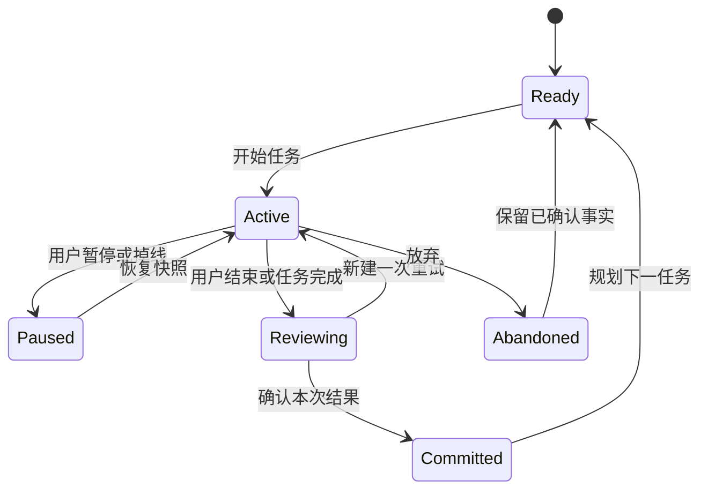
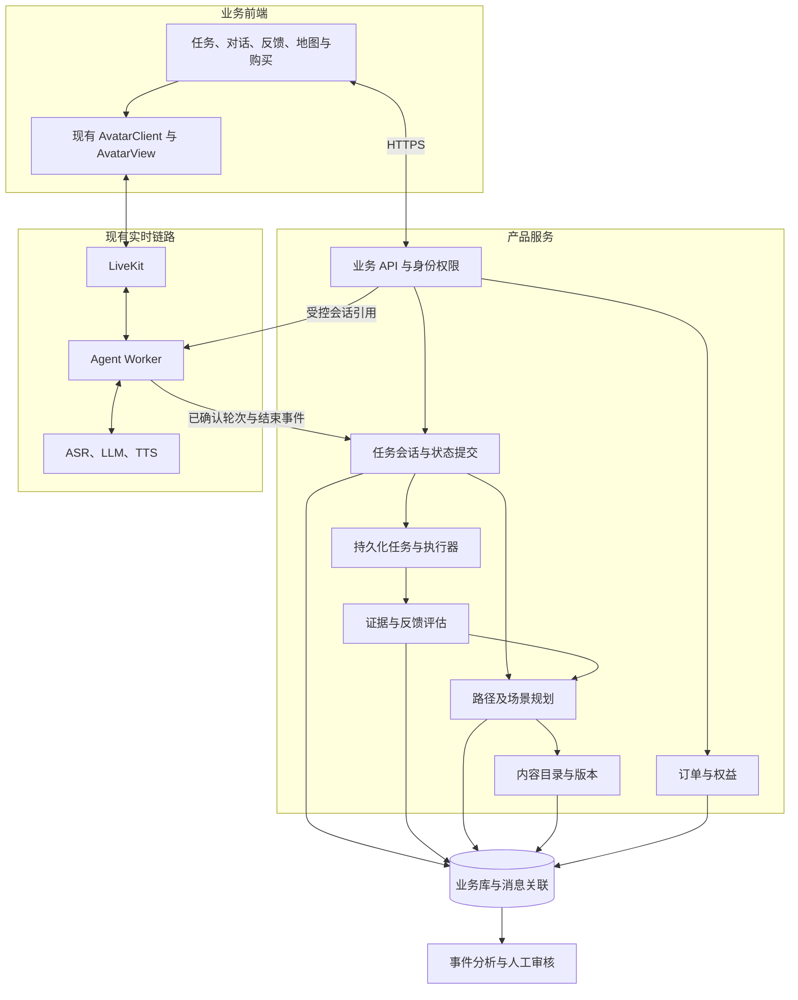
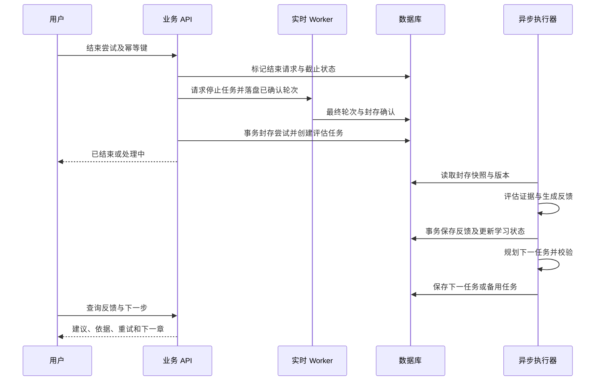

# 剧情式自适应口语产品方案

版本日期：2026 年 11 月 2 日。状态：待验证的产品设计，未实现功能均为规划。业务排期与继续投入条件见 [业务路线图](business-roadmap.md)。

首发产品面向有海外旅行或留学计划、读写尚可但开口困难的成年人。每天约五分钟，通过与 Live2D 角色对话完成故事任务；系统依据实际表现给出最多两条建议，并安排后续练习。首轮目标是验证动态路径是否提高能力迁移、连续剧情是否促进主动复用，以及用户是否愿意购买后续内容。

## 1 产品定位与边界

产品工作名为「故事口语搭档」，不作为已确定的商标或上线名称。面向用户的描述：**每天五分钟，在连续故事里练会真实交流。它记住你的卡点，为你安排下一次挑战。**

| 项目 | 首发选择 |
| --- | --- |
| 核心用户 | 18 岁以上，有未来三个月出境计划，能够说简单英语但难以持续交流的人 |
| 核心问题 | 不知道练什么，场景对话容易卡住，收到纠错后不会继续练 |
| 使用场合 | 安静环境、耳机和麦克风，手机浏览器优先，桌面可用 |
| 核心交付 | 完成一个真实沟通任务，得到有原话依据的改进建议，明确下一步 |
| 首发内容 | 一个海外生活主题、七个章节、一个固定搭档，场景人物可先使用文本身份及审核过的音色 |
| 商业实验 | 免费完整体验一章，再测试七章主题包；明确价格、服务期限、次数和退款规则 |
| 后续扩展 | 留学适应、面试、工作沟通；在首发验证后逐项选择 |
| 首版范围外 | 儿童、开放世界、用户生成故事市场、角色商城、多语言、企业管理后台、精确发音测评、证书或考试分数承诺 |

首轮访谈需要确认用户是否接受卡通角色。获客页面可以用两个角色风格测试点击和完成率，但暂不开发角色定制系统。

## 2 产品方案总图

[查看可编辑的 SVG 方案图](assets/product-overview.svg)。下方保留 Mermaid 流程源码，便于随方案调整。

设计原则是让学习状态与故事状态各自有明确依据。用户未掌握某项表达时，可以推进剧情，同时在后续事件中补练；剧情不会因为一次识别错误被锁死。

## 3 页面与用户流程

### 3.1 信息架构

| 页面 | 核心内容 | 主要动作 | 空白或异常状态 |
| --- | --- | --- | --- |
| 介绍页 | 一段真实演示、目标人群、七章能练什么、试用说明 | 开始首章 | 浏览器不支持时说明可用设备 |
| 目标设置 | 用途、出行日期或时间范围、主观水平、字幕偏好 | 用默认设置开始 | 允许跳过非必要问题 |
| 今日任务 | 上次进度、今日目标、推荐原因、章节预告 | 继续练习、换任务 | 新用户直接进入首章 |
| 对话页 | 角色、任务卡、字幕、提示、静音、暂停、结束 | 开口、请求帮助、完成任务 | 拒绝麦克风可选文字体验；文字不混入口语指标 |
| 反馈页 | 任务完成证据、最多两条建议、原话与改进表达 | 练一次、继续、反馈有误 | 数据不足时说明本次可判断的范围 |
| 故事地图 | 已发生事件、下一章、可选支线、复习任务 | 进入下一任务 | 付费章节清晰展示交付范围 |
| 我的进步 | 已独立完成的能力、待练点、历史任务 | 查看证据、调整目标、删除记录 | 不把一次结果展示为正式等级认证 |
| 购买与权益 | 内容范围、有效期、价格、剩余次数、订单 | 购买、恢复权益、申请售后 | 支付失败可重试，已付款不重复开单 |

### 3.2 首次体验

试用采用临时身份隔离会话与数据。账户绑定需要可验证凭证和明确的数据归属转换，不能通过猜测用户 ID 合并历史。购买前完成账户绑定，防止丢失权益。

### 3.3 一次五分钟练习

下列为体验设计目标，需通过实测调整。设备检查和购买不计入练习时长。

| 阶段 | 参考时间 | 体验 |
| --- | --- | --- |
| 建立任务 | 约 20 秒 | 角色自然开场，说明今天要完成的事 |
| 核心交流 | 约 3 分钟 | 多轮对话，提供可请求的分级帮助 |
| 小变化与确认 | 约 40 秒 | 用户应对追问，检查是否真正完成沟通 |
| 收尾与建议 | 约 1 分钟 | 总结、两条建议、重试或下一集 |

五分钟是节奏目标，不在用户说话中途强行切断。实际用时、用户开口时长、系统说话时长分别记录；剧情旁白尽量短，不能挤占练习。

反馈示例：

> 你已经说明了房间问题，并得到了解决方案。你说的是 “Change room”，下次可以说 “Could I change to a quieter room?”。另一个值得练习的地方是确认安排：“So I can move at two, right?”。现在试一次，还是继续下一集？

### 3.4 异常与退出

| 情况 | 行为 |
| --- | --- |
| 卡住或沉默 | 先等待，再提供关键词；用户可请求完整示例，标记本次提示级别 |
| 没听清 | 角色请求重说，允许用户纠正字幕；修正记录可作为新证据，识别错误不扣能力 |
| 练习太难 | 当前任务降低负担，结束后记录降级原因；允许用户拒绝推荐 |
| 掉线 | 保留已确认对话和任务快照，重连恢复；新连接不能重复推进章节或重复计费 |
| 提前退出 | 保存进度，展示已有证据；没有足够证据则不更新掌握状态 |
| 反馈生成失败 | 显示处理中并重试；不凭空补评分，用户可先回首页 |
| 用户不喜欢剧情 | 可切换直接练习，保留相同学习目标并记录偏好 |

## 4 动态学习路径

### 4.1 首版能力框架

首版采用四项可观察的沟通能力，不直接推断整体 CEFR 等级。用户自评与首章表现只用于选择初始任务难度。

| 能力 | 可观察表现 | 迁移任务例子 |
| --- | --- | --- |
| 提出请求 | 表达想要什么，提供必要信息 | 从入住请求迁移到餐厅特殊要求 |
| 确认信息 | 核实时间、数量、地点和方案 | 从房型确认迁移到租车时间确认 |
| 解释原因 | 说明问题和理由 | 从房间太吵迁移到更换预约 |
| 应对追问与修复误解 | 回答追问，澄清或换一种说法 | 从登记信息误解迁移到问路误解 |

每项能力记录状态、证据数量、最近出现时间、提示依赖和待复习时间。状态采用「待观察、需帮助、练习中、已在多场景独立完成」。模型的不确定性、ASR 可信度和教学表现分开存储。

### 4.2 证据与掌握更新

一条有效证据至少包含：会话与轮次 ID、能力标签、用户原话、任务上下文、是否获得提示、观察结果、评估器版本。记录能否支持判断；没有可靠音频信号时，不生成精确发音结论。

初始业务规则如下，可在专家审核后调整并版本化：

1. 模型只提取观察与候选证据，服务端验证轮次存在、说话人、提示情况和任务条件。
2. 一次提示后成功记为「需帮助」或「练习中」，不记为独立掌握。
3. 至少在两个不同场景、跨两次会话中独立完成，才允许标记为「已在多场景独立完成」。这属于产品规则，不能等同于测量学上的正式掌握认证。
4. 后续失败追加记录并触发复习；一次低可信识别结果不能覆盖已有状态。
5. 用户可指出错误，运营可修正证据并重新计算，保留审计版本。

### 4.3 场景选择逻辑

首版采用明确优先级和人工配置，暂不训练推荐模型。先保证候选任务符合学习目标、授权范围、剧情前置条件和权益，再排序。到期复习、影响沟通的薄弱点优先；用户连续失败时降低难度，连续独立成功时增加挑战。没有匹配剧情时使用独立补练，并说明原因。

推荐应当能够解释，例如「上次你能说明问题，但确认时间还需要提示；今天会在新的情境里练习确认」。保存候选集合、选择理由、规则版本和用户是否接受，才能复盘效果。

复习时间先测试下次会话、约三天后、约七天后的规则；并不保证用户按时返回。错过复习时重新排序，不机械堆积任务。

## 5 故事设计与内容生产

### 5.1 七章首发故事

用户第一次独自到达海外城市，固定搭档通过通话协助处理日常事件。搭档提供安全感和连贯关系，场景角色承担真实对话任务。

| 章节 | 故事事件 | 沟通目标 | 可调整的局部事件 |
| --- | --- | --- | --- |
| 1 | 抵达并办理入住 | 提出请求、确认身份信息 | 询问早餐、入住时间或押金 |
| 2 | 房间出现问题 | 解释问题并提出解决请求 | 噪声、设备故障、房型不符 |
| 3 | 出门赴约 | 问路并确认路线 | 路线变化、地点同名、交通替代 |
| 4 | 与新朋友吃饭 | 表达偏好并应对追问 | 饮食限制、推荐菜、修改订单 |
| 5 | 临时调整安排 | 解释原因并协商时间 | 迟到、天气变化、预约冲突 |
| 6 | 发生一次误会 | 澄清信息并修复沟通 | 取件、租借、账单误解 |
| 7 | 独立完成新任务 | 综合迁移，减少帮助 | 未练过的预约或服务协商 |

第三章可能补练第二章暴露的确认能力，同章内调整追问和提示；不为每种薄弱点维护一整套独立长剧情。分支在章节结束处汇合，限制内容成本。

### 5.2 故事状态管理

故事状态保存当前位置、时间、已确认事实、已发生事件、未解决任务和角色关系摘要。角色不能改变已确认事实；可变事件必须符合章节边界。只存必要的虚构关系，用户个人信息与故事事实分开。

任务完成由服务端结合证据与任务条件判断，模型提出结果建议。章节推进使用事务和版本检查；同一尝试只提交一次。故事上的推进与学习掌握更新分别执行，任务未成功可通过解释、协助或补练继续剧情。

### 5.3 内容模板与审核

每个任务模板需要：模板 ID 与版本、关联章节、前置事实、目标能力、任务成功条件、允许难度、角色设定、开场、可变事件、分级提示、结束方式、禁止变化的事实、备用对话、迁移测试变体。

生产流程为：教研写目标与骨架 → AI 生成候选措辞和变体 → 教研审核语言与难度 → 产品检查剧情与交互 → 发布版本 → 根据失败样本修订。首版仅在审核边界内实时生成，不开放无限新人物和世界设定。

## 6 技术实现方案

### 6.1 当前能力与新增能力

基于仓库 [现有架构](architecture.md)、[会话协议](protocol.md) 及 `backend/avatarweave_agent/db.py`。当前持久化模型主要为房间 Conversation 与 Message，不能直接当作用户级学习记录。

| 能力 | 当前状态 | 本产品需要补充 |
| --- | --- | --- |
| Live2D 渲染、口型、动作 | 已有 SDK 与配置机制 | 场景背景、角色状态和任务 UI |
| 实时语音与文字流 | 已有 LiveKit、ASR、LLM、TTS 组合 | 任务提示、结束条件、提示使用记录 |
| 历史 | 已有房间级消息 | 用户身份、跨会话学习状态、故事状态 |
| 反馈与路径 | 待开发 | 证据评估、规则规划、推荐理由 |
| 内容 | 已有角色与音色配置 | 章节模板、审核、版本及回退 |
| 商业能力 | 本方案新增范围 | 权益、订单、埋点、人工运营和评估 |

### 6.2 架构图

对话主链只读取当前任务快照和精简上下文。详细反馈、掌握更新和下一任务规划在练习结束后异步执行；运行时卡住处理采用已有任务中的分级提示。首版采用同一后端内的模块与持久化任务表，不要求拆成多个微服务或部署多智能体集群。

### 6.3 仓库落点建议

以下路径为建议新增位置，当前并不存在这些业务模块。

| 位置 | 责任 |
| --- | --- |
| `apps/learning` | 独立业务前端；复用 SDK，保留 Demo 的参考用途 |
| `backend/avatarweave_agent/learning/identity.py` | 试用身份、绑定、授权及数据归属 |
| `backend/avatarweave_agent/learning/sessions.py` | 任务尝试、状态机、快照、结束幂等 |
| `backend/avatarweave_agent/learning/evaluation.py` | 原话证据、反馈、可信度、审核状态 |
| `backend/avatarweave_agent/learning/planner.py` | 能力复习、任务选择、推荐理由 |
| `backend/avatarweave_agent/learning/story.py` | 章节状态、事实约束、分支汇合 |
| `backend/avatarweave_agent/learning/jobs.py` | 可重试任务、超时、死信和恢复 |
| `backend/avatarweave_agent/learning/commerce.py` | 权益、订单、支付回调幂等 |
| `config/learning` | 人工审核过的版本化内容源文件 |
| `backend/tests/learning` | 状态、权限、评估与规划的必要测试 |

首轮内容管理可用文件审核与发布脚本，不先建设大型 CMS。数据库需要正式迁移机制，不能继续仅用 `create_all` 处理已有表升级。

### 6.4 数据模型

| 实体 | 核心字段 | 关键约束 |
| --- | --- | --- |
| Learner | 用户 ID、身份状态、目标、偏好、同意版本 | 试用与正式身份的绑定可审计 |
| Enrollment | 用户、内容包、内容版本、实验分组 | 一个用户的分组稳定且服务端生成 |
| LessonAttempt | 用户、任务、房间、状态、快照、起止时间 | 重试生成新 ID，归属于同一个目标 |
| SkillEvidence | 尝试、轮次、能力、原话、提示级别、观察、版本 | 引用真实用户轮次，支持撤回与修订 |
| LearnerSkill | 用户、能力、状态、证据引用、到期时间、版本 | 按用户与能力唯一，更新有并发保护 |
| StoryProgress | 用户、内容包、章节、事实、未完成事项、版本 | 事实变更可追溯，不与能力状态混用 |
| Feedback | 尝试、任务结果、最多两条建议、证据引用、状态 | 同一评估版本重复执行不重复发布 |
| PlanDecision | 用户、候选、选中任务、理由、规则版本、状态 | 保留拒绝、换题与回退原因 |
| Job | 任务类型、关联尝试、状态、次数、下次运行时间 | 幂等键唯一，失败可恢复 |
| Entitlement 与 Order | 用户、商品、有效期、支付状态、交易引用 | 支付回调验签，退款后同步权益 |
| ProductEvent | 用户或试用 ID、尝试、事件、分组、时间 | 避免分析事件重复携带完整对话 |

### 6.5 API 与实时边界

建议增加下列业务 API，最终命名在实现评审时确定。

| API | 用途 |
| --- | --- |
| `POST /api/learning/trials` | 建立受限试用身份 |
| `PUT /api/learning/profile` | 更新目标与偏好 |
| `GET /api/learning/today` | 获取下一任务、推荐原因及权益 |
| `POST /api/learning/attempts` | 创建尝试并锁定内容、规则及实验版本 |
| `POST /api/learning/attempts/{id}/connection` | 校验归属后签发该尝试的实时连接凭据 |
| `POST /api/learning/attempts/{id}/finish` | 幂等结束并提交评估任务 |
| `GET /api/learning/attempts/{id}/feedback` | 读取生成状态、建议和证据 |
| `POST /api/learning/attempts/{id}/retry` | 在原目标下创建新尝试 |
| `GET /api/learning/progress` | 查看学习与故事进度 |
| `POST /api/learning/feedback/{id}/dispute` | 报告错误反馈 |
| `POST /api/learning/orders` | 绑定账户后创建订单 |
| `POST /api/learning/payment-callback` | 支付方回调，按交易唯一键更新订单 |

复用 `avatarweave_session` envelope，`context` 只传短小的任务引用，例如 `lesson_attempt_id`；服务端校验后签发，Agent 读取服务端快照。不信任浏览器传来的能力状态、角色事实或权益。继续保持 metadata 的 4096 字节限制，不在其中传完整学习历史。

动作沿用 `avatarweave.command.v1`，转写沿用现有 Text Stream。反馈和进度走业务 API，首版可以短轮询生成状态；业务功能不再新增一套动作或转写协议。

### 6.6 结束与异步处理

Worker 异常退出时，通过最后心跳与已落盘轮次恢复封存。没有最终音频或文本时标记部分完成；晚到轮次进入受控重评，不直接反复推进状态。评估、学习状态更新和剧情提交使用不同的幂等键及输入版本，防止重复事件和并发会话造成覆盖。

## 7 质量与上线条件

以下为首轮内部验收目标，不是已测结果，也不是行业标准。第一个技术基线周根据实际供应商、设备和网络重新确认。

| 维度 | 首轮验收目标与测量方式 |
| --- | --- |
| 对话响应 | 记录真实用户说完到首次可听回复的 P50、P95；暂以 P50 不超过 2 秒、P95 不超过 4 秒为目标 |
| 打断和识别 | 单独记录误打断、字幕纠正、识别失败；覆盖犹豫、口音、夹中文和弱网样本 |
| 稳定性 | 麦克风就绪后的练习中，无系统故障阻断比例暂定至少 95%；保留全入口失败漏斗 |
| 反馈速度 | 尝试封存后到反馈可用的 P95 暂定不超过 15 秒，超时可恢复 |
| 反馈依据 | 首批抽查至少 50 份报告，至少 90% 的建议可由真实轮次支持；身份串用或捏造原话必须阻止上线 |
| 推荐质量 | 首批抽查至少 30 次选择，至少 90% 满足目标能力、难度、权益与剧情前置条件 |
| 状态可靠性 | 重连、重复结束、任务重试、并发尝试和支付重复回调不重复推进或重复发权益 |
| 手机可用性 | 至少覆盖 iOS Safari、Android Chrome 和桌面 Chrome 的真实语音主流程；记录具体版本 |

测试重点放在权限与数据归属、有效证据、状态更新、规划回退、真实语音体验和订单一致性。人审样本需覆盖失败和退出场景，不能只抽查成功完成的会话。

隐私设计与产品功能一同实现：音频默认实时处理而不长期保存；如需质量回放，另行取得同意并设置有限保留期。文字历史与学习摘要支持查看、删除和保留期配置。删除请求覆盖摘要、证据、分析标识及备份到期策略；支付记录按适用的业务与法律要求处理。上线地区和收款主体确定后完成针对性审查。

## 8 实验与衡量

### 8.1 三组产品实验

| 分组 | 体验 | 对比问题 |
| --- | --- | --- |
| A | 独立场景与反馈，固定顺序 | 基础体验是否有价值 |
| B | 根据薄弱点安排新场景与反馈 | B 相对 A 是否改善能力迁移与使用 |
| C | 动态路径、反馈与连续故事 | C 相对 B 是否增加主动复用和购买 |

三组使用相同角色、音色、相近任务难度、时长、内容量、反馈质量、价格和提醒方式。按用户随机分组并锁定；记录跨组污染、缺失与退出。连续故事与独立场景无法完全盲测，因此保留定性访谈和学习评估盲评。

首批 30 至 60 人只用于可用性和方向判断。正式比较先确定主指标、最小有意义改善、功效和样本量，再扩招；小样本不能用任意提升比例宣布成功。

### 8.2 指标定义

| 指标 | 口径 |
| --- | --- |
| 激活率 | 首章结束且反馈可见的用户数 / 进入首章的去重用户数 |
| D7 复用率 | 首练后第 7 个本地自然日再次开始有效语音任务的用户 / 首练用户；仅纳入观察窗完整的批次 |
| 七日多次练习率 | 首练日起七个本地自然日内，在至少三天完成有效练习的用户 / 首练用户 |
| 有效练习 | 暂定用户累计发声至少 60 秒且产生至少三次有效用户轮次；同时保留原始时长分布，不能用阈值隐藏短会话 |
| 能力迁移 | 在未练过的等价任务中，无完整句提示完成目标的比例；首测、后测与延迟测使用不同题目 |
| 付费转化 | 净支付人数 / 完整获得相同付费邀请的去重用户数，并同时报告从全部激活用户起算的比例 |
| 复购与续费 | 到期且拥有完整续费窗口用户中的净续费比例；内容包复购与月订阅分别报告 |
| 服务贡献 | 净收入减实际模型、语音、支付、变动基础设施及直接服务成本；与包含获客、人员固定成本的利润分开 |

核心阶段指标为「一周至少三天练习且延迟迁移任务有改善的人数」，同时展示两个分项和失访率。迁移评估由不知道分组的人抽样盲评，使用同一评分准则，不能只靠产品自己的分数。

### 8.3 埋点与审计

事件包括 `landing_view`、`trial_start`、`mic_ready`、`attempt_start`、`hint_used`、`attempt_end`、`feedback_ready`、`retry_start`、`recommendation_accepted`、`recommendation_changed`、`paywall_view`、`payment_success`、`refund`、`transfer_test_complete`。

公共字段包括事件 ID、服务端时间、用户本地日期、匿名或正式用户引用、尝试 ID、实验组、内容版本、规则版本、设备和原因码。付费与权益使用服务端事件为准；事件 ID 去重，音频与完整文本不写入通用埋点。

## 9 首版交付清单

| 交付物 | 完成条件 |
| --- | --- |
| 体验 | 手机完成首章、反馈、重试、保存进度与下一章 |
| 学习 | 四项能力均有证据与提示级别，推荐可解释、可拒绝、可回退 |
| 剧情 | 七章骨架与关键事实一致，掉线恢复、退出和分支汇合可用 |
| 内容 | 发布前审核，模板、反馈规则、实验版本可回溯 |
| 商业 | 商品交付清晰，订单、权益、退款和客服流程可执行 |
| 运营 | 能定位失败会话、审核报告、处理反馈争议与删除请求 |
| 验证 | 稳定分组、成本记录、漏斗、迁移测试和人审样本可导出 |

按 [业务路线图](business-roadmap.md) 逐阶段交付。先上线首章闭环，再增加动态路径，最后验证连续故事的额外价值。

## 10 竞争依据与待验证假设

Praktika 已公开介绍持续跟踪学习表现、长期规划与记忆机制；因此动态路径本身不能作为独家能力。[Praktika 产品案例](https://openai.com/index/praktika/)

ELSA 已公开个性化学习路径、角色扮演与自定义场景；Duolingo 已有角色通话和故事任务。[ELSA 产品更新](https://blog.elsaspeak.com/en/discover-the-new-elsa-speak-experience/)、[Duolingo Adventures](https://blog.duolingo.com/adventures/)

本产品需要验证的是：针对明确人群，将历史薄弱点嵌入跨章节故事，是否比相同质量的独立练习带来更好的迁移、复用及付费。这是产品假设，现阶段不承诺学习效果或融资结果。
