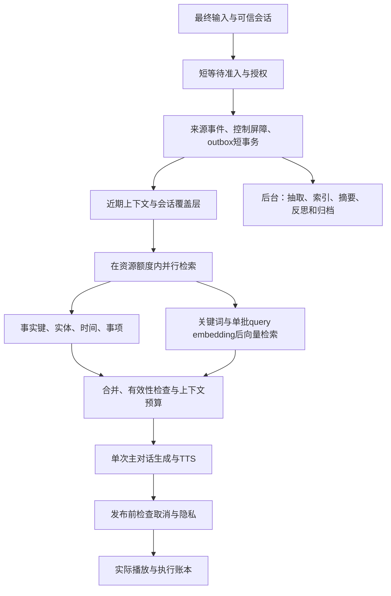

# 性能、并发、记忆新鲜度与质量联合验收规范

版本：0.3 审核稿。对应 [主方案](../voice-memory-implementation-plan.md)。本规范是实现和阶段验收的约束，不是现有实测结果。数值为建议首发门槛，须在 P0 冻结硬件、供应商、数据集和测试负载；修改门槛必须形成版本记录，不允许压测失败后悄悄放宽。

目标是同时满足：语音足够快、其他用户不被慢任务拖住、记忆有可验证质量。并发不表示无需任何锁，也不承诺无限流量；质量不表示模型永不犯错。

## 1 执行路径与禁止等待的工作

### 1.1 三类用户路径

| 路径 | 必需工作 | 默认不等待 | 返回要求 |
| --- | --- | --- | --- |
| 普通实时对话 | 授权与版本；短输入事务；会话覆盖层；有界查询/检索/上下文；必要发布检查 | 完整抽取、模型查询扩展、模型重排、语气模型、压缩、反思、归档和索引重建 | 能回答则直接回答，不能证实时澄清；不伪装完整历史已查完。 |
| 记忆控制 | 明确的 UI 纠正、pin、删除、隐私变更的持久提交与失效屏障 | 重建所有派生、重算 embedding、清理所有物理副本 | 成功后下一轮符合新控制；响应区分已撤销和仍在清理。 |
| 深度回顾 | 用户明确需要的多事件/历史检索、冷层读取、补证和组合推理 | 无关全历史扫描与全部后台维护 | 标明正在查找或证据不足；进度回应不能当最终事实答案。 |

普通话题切换不自动启用深度回顾；用户请求涉及多事件推理或冷层资料时，路由到明确的较长预算。禁止把所有慢请求重分类成“深度回顾”以美化普通延迟。

路径识别先于预算分配；若普通请求执行中才发现必须冷查，保留该请求的 partial/降级统计，结束其已分配 deadline，再创建用户可见的有界 deep_recall 工作。不能悄悄延长原父预算或改写原请求类别。

自然语言纠正可先记录来源和建立“相关旧字段待核验/不作为确定事实”的屏障；无歧义可短事务更新。需要模型解释或用户澄清时，不在实时事务里等待推理，不声称事实已经更新完成。UI 结构化更正可直接走确定性提交。

### 1.2 实时流程与并行边界

并发查询各自使用独立 AsyncSession，不共享一个可变数据库会话。精确事实/关键词不必等 query embedding；需要同一 embedding 的向量查询合批，不能为每路重复请求供应商。只对真正独立步骤并行，不并行执行有版本依赖的提交。

普通路径每个回合额外模型生成调用默认 0：查询扩展和语气优先规则/缓存；主对话本身仍调用一次对话模型，工具引发的必要后续调用单独记录。一个回合最多一次 query embedding 批次，预算内失败使用允许的其他通道并报告降级。

在线重试默认 0；幂等控制重试及必要重新读取，只有剩余预算足够时允许一次。禁止每个依赖独立重试三次造成尾延迟叠加。

### 1.3 在线预算

普通记忆准备预算从最终输入进入记忆执行器开始计算，包含资源排队、短输入提交、query embedding、检索、组装和该次准备检查：

| 阶段 | 初始最大分配 | 约束 |
| --- | --- | --- |
| 准入与调度等待 | 20 ms | 超过就停止扩展或返回明确过载，不无限排队。 |
| 输入持久化/覆盖层与必要读取 | 60 ms | 无模型/对象存储调用；控制事务独立目标见第 3 节。 |
| 有界检索分支 | 150 ms | 包括 embedding 等待；独立分支可同时执行。 |
| 合并与上下文构造 | 50 ms | 固定数量、大小和 token 上限，避免无界 CPU 工作。 |
| 准备完成前的最终栅栏 | 20 ms | 无新模型调用；检查当前授权/代次。 |

总 hard budget 300 ms，P95 目标 200 ms；分项是最大分配起点，不是各项 P95，不能相加估计实际 P95。未用预算可转给下一阶段，子阶段 deadline 不超过父 deadline。主对话、ASR、TTS 与后续每个发布检查在端到端时序另计，不藏进“记忆已经完成”。

临近 deadline 时停止新的可选分支，收集合规已完成候选；安全、删除及版本检查不能为了准点而省略。无法保证这些条件则失败或请求稍后再试，不返回带旧隐私数据的成功。

RequestMeta 的 UTC 时间用于审计；实际剩余预算采用单调时钟。墙钟回拨不能延长执行；十年模拟时钟只改变事件语义时间，不伪造 CPU/网络耗时。

300 ms 仅是记忆准备子调用 deadline，不是主 LLM/TTS 的总 deadline。首个实质回答音频的根 hard deadline 初始为普通 4s、warm 回顾 8s、cold 回顾 15s；P95 目标仍分别为 2.5s/5s/10s。每个子调用按所属阶段从根剩余预算取最小值，不能把 300ms 原封不动传给整个主模型。首段开始后流式持续输出采用独立有界阶段（初始总长 30s、读空闲 5s），继承取消/隐私/代次，不在已过期根调用内无限续命。

## 2 并发、事务与资源隔离

### 2.1 资源清单必须可计算

P0 建立 CapacityManifest，记录机器 CPU/RAM/GPU、进程数、DB max_connections、各进程池上限、供应商 RPM/TPM/并发、对象存储和带宽。没有该清单不能宣称支持某个并发量。

数据库预算：

Σ[进程数 × (pool_size + max_overflow)] + 运维/迁移保留连接 ≤ 0.70 × max_connections。

该比例是初始安全预算，余量覆盖连接故障和其他任务；实际还需 CPU/I/O 压测。Agent 若每会话独立进程，连接数随会话增长，不能只算一个 Worker 的池。默认不为每个 Agent 创建 5+10 个溢出连接。

起步示例：2 个 API 进程各 5 连接、10 个 Agent 子进程各 1 连接、2 个后台进程各 2 连接、运维保留 6，总上限 30。若 max_connections=100，则满足连接预算，但不证明吞吐达标。50 个 Agent 下为 70；100 个 Agent 下为 120，不满足，必须先调整部署/池化再测试。此示例不修改部署，也不自动批准扩大数据库。

这里每 API 的 5 连接是各通道合计，例如 control 2 + dialogue 3，实际清单拆成两个池条目计算；不能为每个通道都各开 5 个再沿用总数 30。

若单会话池为 1，该会话的 SQL 查询按短占用顺序执行，跨用户仍可并发；不得同时宣称同会话所有 SQL 真正并行。需要同会话 SQL 并行时显式增加池并重算全局连接预算，或采用经评审的集中访问/连接复用方案。

### 2.2 资源通道

- control：纠正、删除、授权变化及轻量状态读取，拥有独立保留额度。
- dialogue：普通记忆检索与主对话，额度优先于维护。
- deep_recall：用户等待的较重查询，单独限额。
- maintenance：抽取、压缩、归档、重索引，剩余预算内运行。

在线与后台分开数据库池、供应商额度和 CPU 任务执行池；它们仍可能共享数据库 CPU/I/O、GPU 与网络，因此需同时压测，不能把“进程不同”视为完全隔离。

每类供应商服务分别计算额度；若在线和后台使用同一账号，统一总限额，不能每进程各拿一份完整配额。采用共享额度协调或预分配互不重叠份额，多实例重启也不能超发。

首发逻辑起点：每会话最多 1 个有效 generation；每用户最多 2 个同时运行会话；每回合最多 4 个运行中的检索分支，额外等待节点有界。部署级限额由容量清单决定，不硬编码“全局无限”。

### 2.3 事务和锁

- 网络模型调用、embedding、对象读取、压缩/解密、等待浏览器回执，均不得放在持锁事务里。
- 事实变更按事实键或必要行锁保护；用户 memory_revision 只在提交瞬间递增，不在整个推理期间占用用户级锁。
- 同时操作多个键按固定排序取锁；冲突后有限重读，不无限抢锁。
- 普通读取不锁住全部历史；任务认领可用 SKIP LOCKED，但事实读取不能跳过锁定行后假装得到完整正确集合。
- 初始 lock_timeout 50 ms，普通 SQL statement_timeout 150 ms，短提交事务总时长目标不超过 100 ms；单次实时流程仍受 300 ms 总预算，不能各项分别用满。
- 后台 SQL 按批次执行，默认最多 100 条起步、单事务最长 1 秒；更大迁移由独立任务分批，不让一次删除/归档长事务锁住所有用户。

锁超时返回可解释冲突/依赖错误或重试；不能静默丢纠正。数据库会话的线程/协程安全边界见 [SQLAlchemy](https://docs.sqlalchemy.org/en/20/orm/extensions/asyncio.html)。

### 2.4 CPU 与事件循环

I/O 使用真正异步客户端或受限 I/O 执行池。纯 Python 重 CPU、批量 tokenizer、压缩、解密和大规模解析使用受限进程池或独立任务进程；线程是否足够需验证 GIL 与扩展行为，不一律“to_thread 就解决”。[Python asyncio](https://docs.python.org/3.11/library/asyncio-task.html#asyncio.to_thread)

测量事件循环 lag、CPU、内存、线程/进程队列和任务年龄；后台运行期间实时 Worker 的 loop lag P95 初始目标 ≤20 ms。该指标单独通过不能替代真实音频延迟。

如使用本地 Kokoro，现有推理锁会使短句合成串行排队。必须单独报告每实例合成能力、等待、实际播放延迟和支持的会话量；采用多实例/设备或供应商路由须验证资源和质量，不能直接删除锁绕过共享 phonemizer 安全边界。

## 3 记忆新鲜度、可见性与成功语义

### 3.1 状态与水位

事件已接受、原始来源持久、当前会话可用、结构化判定完成、索引完成、跨会话已可读是不同状态。source/structured/index 水位使用同一用户输入序列，并表示“连续已处理前缀”；不能用最大完成序号跳过中间洞。

判定“无需保留”的事件也可 settled；水位推进不代表每句话都被写成事实。纠正等关键操作另有目标事件状态，避免被前面不相关慢任务阻塞确认。

同会话覆盖层可覆盖尚未处理成结构化记忆的新原话，但必须标记 provisional，不当作最终画像；新会话先读可信来源增量/目标事件状态，再查向量，不能把“尚未索引”当“从未说过”。

### 3.2 初始时限

| 操作 | SLO 或必须行为 | 时间起点 |
| --- | --- | --- |
| 最终事件持久化确认 | P95 ≤100 ms | 进入已准入的输入处理器，含必要连接等待。 |
| 当前会话使用新输入 | 下一有效最终回合可见，未处理内容以原话/待确认状态呈现 | 输入持久提交后。 |
| 明确 UI 纠正完成 | P95 ≤300 ms；成功后任何新读取使用正确版本 | 控制请求准入后，包含事务与屏障。 |
| 歧义语音纠正 | 下一轮不以疑似过时字段作确定结论；返回待核验/澄清 | 识别到控制意图后；不能谎称已结构化更新。 |
| 普通来源结构化 settled | P95 ≤5 秒，P99 ≤15 秒 | 原始来源持久提交后，包含队列。 |
| 普通向量索引 settled | P95 ≤10 秒，P99 ≤30 秒 | 同上，不能只报 embedding 网络耗时。 |
| 换房间/设备查看刚提交事件 | P95 ≤300 ms 可见持久来源/处理状态 | 恢复会话或查询状态；不承诺结构化与向量已完成。 |
| 删除逻辑撤销 | P95 ≤300 ms；撤销响应后的新读不返回目标 | 授权控制准入后；物理清理另报。 |

复杂待确认、明确 provider 故障或大批维护单独分类，但计入失败/待处理统计，不通过把慢普通事件全改标签规避上述时限。缺失或 stuck 事件必须进入状态查询和告警，不无限 pending。

### 3.3 成功用语

“收到”只表示接受；“已保存本次记录”要求来源持久；“已更新这条记忆”要求相应结构化事务与屏障成功；“还在整理”不能被 UI 显示成全部完成；“已删除”展示逻辑不可用与物理清理进度的区别。

UI 使用 MemoryVisibility 与目标事件状态，不通过“接口没报错”猜测长期记忆已经可检索。

## 4 超时、取消、背压与公平性

### 4.1 截止时间传播

所有子调用用父请求剩余 budget；连接池等待、供应商信号量等待、HTTP 连接/读取、SQL、组装均计时。已无预算不再新建昂贵调用。可选模型查询扩展和重排默认关闭；只有验证额外收益且不突破路径预算才启用。

取消信号覆盖用户打断、输入修订、owner 失效、privacy 变化和 deadline。可取消 I/O 显式取消并关闭流，回收连接和信号量。超时响应后仍追踪资源是否释放。

无法强制终止的 ONNX/CPU 任务不得靠取消 asyncio 包装器就视为终止：维持有限执行槽，标记 detached_bounded，拒绝旧结果发布，在任务真正结束后释放。只允许已申领槽的有限脱离任务，无界“后台继续跑”是验收失败。

旧结果能否用于缓存必须再次验证 scope、隐私、来源和模型版本；默认取消结果不自动写入用户画像，也不因完成而恢复旧输出。

### 4.2 背压与队列

- 在线 waiting room 有数量与时间上限；普通等待上限 20 ms，满时优先停可选分支，仍不满足则返回 overloaded/retry_after。
- 交互深查与维护队列分别设容量。单用户不能占满全部后台槽；按用户公平轮转并预留 control。
- 维护的重复请求按相同来源水位合并；不丢未完成的来源/纠正/删除事件。维护队列满时允许合法 outbox 暂存，满载持续则限流新的可选记忆写入或会话并明确告知，不无限堆积。
- 队列容量需同时约束条数、payload 总字节与最老年龄。不得把正文搬进另一张无界 outbox 表就宣称有界。
- 达到磁盘高水位时停止可选维护与新保存承诺，保留控制与已购/已接受服务的必要资源；不得丢弃已确认持久事件。
- 删除/授权控制不因普通维护积压被饿死；公平调度不免除所有控制操作的资源上限。

数据库工作认领机制只负责短事务互斥，不能保证 CPU、I/O 或供应商容量无竞争。[PostgreSQL SELECT](https://www.postgresql.org/docs/17/sql-select.html)

## 5 质量指标与初始上线门槛

### 5.1 数据集与裁决

预冻结 held-out 数据集：至少 1000 个跨会话问题，事实/时间更新/多事件/冷层/澄清等关键类各至少 100 个，可以多标签。已有 100 基础案例用于开发回归，不能单独作为上线质量证据。

安全与工程硬条件至少各 1000 次跨用户/删除恢复/重复及并发状态操作，可由参数化故障回放产生。0 次违规表示本次测试没有发现，不能证明现实中永远为零。

期望事实与有效时间来自人工核对或确定性事件图；不只让同一个模型生成答案并判自己正确。压缩、语气及复杂归因做独立人审抽样并报告分歧。模型/提示调优不得使用 held-out 测试答案；泄露后更新数据集版本。

### 5.2 指标口径

| 指标 | 分母与定义 | 建议初始门槛 |
| --- | --- | --- |
| 事实写入精确率 | active 原子断言中被来源和时间支持的比例 | ≥98%。 |
| 重要信息写入召回 | 用户明确要求记住/确认重要的信息中，正确持久保留的比例 | ≥95%；pin/明确控制的确定性测试必须全通过。 |
| 普通重要候选召回 | 按冻结标注应保留的信息中，准入与抽取正确保留的比例 | ≥90%，与重要信息分开。 |
| 检索所需证据完整率 | 可回答问题中，进入上下文的证据覆盖全部必要事实的比例 | 总体 ≥95%；关键分组各 ≥90%。 |
| 时间与更新回答正确率 | 有明确时间/变化预期的问题中，事实、时间和当前版本均正确 | ≥95%。 |
| 有依据回答正确率 | 可回答问题中答案正确且所有实质个人断言有合法来源 | ≥95%。 |
| 无依据个人断言率 | 最终回答中无有效来源支持的实质个人断言 / 全部实质个人断言 | ≤1%；分子、分母逐项人审或可审计裁决。 |
| 正确澄清/拒答率 | 不可回答或有歧义问题中，未编造且做合理澄清/拒答的比例 | ≥95%。 |
| 过度拒答率 | 可回答问题中，错误拒答或无必要要求用户重复的比例 | ≤5%；不能用全部拒答压低幻觉。 |
| accepted 压缩 mandatory coverage | 通过压缩中的 mandatory 事实正确保留比例 | 100%；失败压缩必须拒绝、保留源。 |
| accepted 压缩来源合法性 | 被接受摘要中的 claim 引用与时间/否定均被支持 | 硬反例全通过；人审事实精确率 ≥99%。 |
| 冷层可恢复正确率 | 已保留且可恢复的目标历史事件中，正确检索并回答比例 | ≥95%，未完成和缺失不能排除分母。 |
| 越权、删除复活、已取消动作重放 | 每项独立故障/并发测试的违规次数 | 本次测试均为 0，任何一次阻断发布。 |

召回率不只看“候选里出现”，必须报告候选召回、选入上下文召回与最终正确回答三层。多事件题用“全部必要证据覆盖”评估，不让只找到一个事实的系统拿满分。

报告点估计、分子/分母、95% 置信区间与失败清单。阈值是本项目待审核起点，不是行业标准；不以少量样本达到 95% 宣称产品永久可靠。

### 5.3 复杂度自适应

| 查询类别 | 起始输入/记忆预算 | selected / queries 上限 | 处理 |
| --- | --- | --- | --- |
| 普通延续/单事实 | 6000 / 1200 tokens | 8 / 3 | 普通实时 deadline。 |
| 明确多事件历史回顾 | 10000 / 3000 tokens | 16 / 4 | deep_recall，单独时限与限额。 |
| 复杂跨年组合 | 16000 / 5000 tokens | 24 / 5 | 先补证、逐步归并；超限询问范围或分段。 |

这些是允许的上限，不是每轮必须填满。provider 上下文不支持时降低输入并显式分段，不突破能力。不能对所有任务固定截成八条后要求跨年多事件准确。

现有 rank 权重、半衰期、温度日期都属于可测基线；通过固定对照/消融选择，不能把参数表当作已证明效果最优。

## 6 固定负载下的联合验收

### 6.1 冻结测试条件

CapacityManifest 至少包含：提交/依赖版本、算法与提示、模型供应商与限额、token预算、硬件和进程、DB池与数据规模、冷热比例、网络/浏览器、缓存状态、任务积压基线、数据集与负载配置。

数据档：每用户 2000、20000、约 146120 条十年记录，另有 730600 条高密度用户；数据不全放 warm，按实际分层比例并标 pin、关系和来源。十年冷层规模与过载测试必须包含，不只测空库热缓存。

建议容量档：

| 档位 | 同时活跃语音会话 | 最终输入到达率 | 用途 |
| --- | --- | --- | --- |
| L1 | 10 | 1 轮/秒 | 首个工程闭环容量门槛。 |
| L2 | 50 | 5 轮/秒 | 首发推荐目标，预算与供应商满足后验收。 |
| L3 | 100 | 10 轮/秒 | 扩展目标；未通过不对外宣称支持。 |

到达率是独立于响应速度的 open-loop 负载，避免系统越慢发压越少的假象。混合流量初始为普通 80%、多事件/冷回顾 10%、控制 10%；按类别分别统计。保持真实用户轮次与连续语音占用，不能用空闲连接数冒充语音处理并发。

L1/L2/L3 是建议验收档，不是部署能力承诺。P0 可因实际业务选择不同目标，但必须在实现前版本化冻结；首发可声明容量以通过的最高完整档为准。

### 6.2 测试阶段

每档预热 10 分钟、稳态 30 分钟、2 倍到达率突发 5 分钟、恢复观察 10 分钟。至少三次独立运行，另做不少于 2 小时稳定性测试。首次小规模验证可用短测试定位问题，但不能代替完整验收。

同时运行按实际每轮会产生的抽取/索引、周期压缩与归档任务；额外制造约 10 分钟维护积压及单个大用户回顾。分别测后台关/开两组，不能只在完全空闲维护下验收。

故障包括：query embedding 超时、SQL锁竞争、供应商限流、冷存储延迟、Worker中断、CPU任务不能即时取消、删除中迁移及重复消息。故障组单独报告，不把故障全部混入正常时限掩盖正常表现。

### 6.3 同时通过的条件

1. 普通语音端到端 P50≤1.5s、P95≤2.5s；记忆准备 P95≤200ms；内存/连接/队列不持续增长。
2. 多事件 warm 回顾的实质答案 P95≤5s，需冷层的 P95≤10s 起始目标；进度提示不算最终答案。超时率与完整回答率单独报告，不能通过无意义首句计时。
3. 符合接入容量的稳态普通请求，过载拒绝率与非用户取消系统错误率各≤1%；降级率≤5%。所有超时/拒绝均入分母，未完成不能从延迟样本中悄悄删除。
4. 后台开启相对关闭，普通延迟 P95 增幅≤20%，且两组都满足绝对门槛。控制时限和记忆新鲜度同时满足；维护积压在负载恢复后可排空。
5. 单个慢用户/批量任务不会耗尽保留 control/dialogue 额度；正常其他用户 P95 增幅≤20%且仍满足绝对门槛。
6. 原测试集在该负载下同时通过第 5 节质量门槛。采用相同问题配对比较，完整系统相对单用户质量不下降超过 2 个百分点；报告置信区间，样本不足不能断言无退化。
7. 三次稳态运行都通过；发现任何硬安全/状态违规即阻断发布，不用平均分抵消。
8. 突发组允许有限拒绝，不承诺超额流量也全部低延迟；但队列有界、已接受数据不丢、无越权/复活，恢复后 2 分钟内普通流量恢复到门槛。最长旧任务清理由其 lease/实际 CPU 任务上界单列，不能无限残留。

端到端从用户实际结束说话到设备观测到实质回答播放；轮次判定、ASR、准备、模型、TTS、网络及客户端均包含。合成压测、云模型和真实浏览器分别测；没有浏览器/设备证据时只称服务端性能测试。

### 6.4 防止“指标达标但产品变差”

固定质量数据、问题范围、模型、语音和预算，不临时关闭记忆、减少召回证据或把复杂题排除。压测中 deadline 导致未检索到必要事实时，记为未完成/降级并影响质量或覆盖，不允许以一句“我不记得”算成功。

统计并存：成功请求延迟、全部请求结果分布、超时/拒绝、最终完成时限和质量。请求取消区分用户主动、过载诱发断开与系统取消。

成本同时记录主对话、embedding、抽取、维护、冷读、重试与 detached 工作；不能把开销转到后台就说变便宜。

## 7 契约、阶段门槛与报告

[工程契约](contracts/05-engineering.md) 定义 CapacityManifest、ExecutionReport、MemoryVisibility 公开投影、指标计数与联合验收报告；[共享类型](contracts/00-common.md) 定义每请求 ExecutionControl、可见性要求、取消与错误。它们不替代真正的信号量、deadline或数据库约束实现。

- P0：冻结容量档、指标、数据集、字段和降级策略；先核查池总量、供应商额度、Kokoro容量。
- P1/P2：验证短事务、来源/结构化状态、控制屏障与可见性，禁止假保存。
- P3：真实普通语音路径与超时取消；对照验证召回和上下文，不靠放大 token 绕过预算。
- P4/P5：后台干扰、长作业、语音输出取消、队列公平性与重连。
- P6：三项同时验收、故障/十年/迁移/冷层/删除；提交完整报告，未通过不进入 P7。
- P7：仅按已通过容量灰度，保留在线观测与版本回退。

报告至少含：冻结清单、负载档、每类请求数、质量分子/分母及区间、各阶段及端到端 P50/P95/P99、拒绝/降级、池与资源占用、积压/水位、取消后残留、成本、硬违规、失败案例、三次结果和结论。

每个完整负载档的必需 gate ID：G01_ordinary_latency、G02_memory_preparation、G03_recall_completion、G04_request_outcomes、G05_interference、G06_visibility、G07_bounded_resources、G08_quality_overall、G09_quality_subgroups、G10_critical_zero、G11_repeatability、G12_recovery、G13_evidence_manifest。一个 gate 内的多个条件全部满足才算通过，原始测量与固定比较器负责复算，不允许只给一个模型自报的 passed。

本文只规定设计和验收。尚未运行真实压测、算法实现或生产故障演练，不能把文档数值当作已通过成绩。

