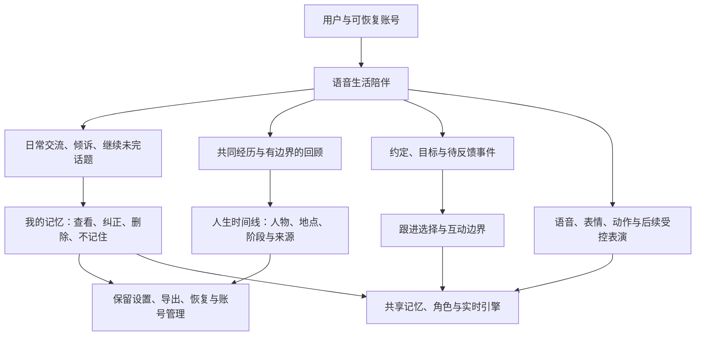
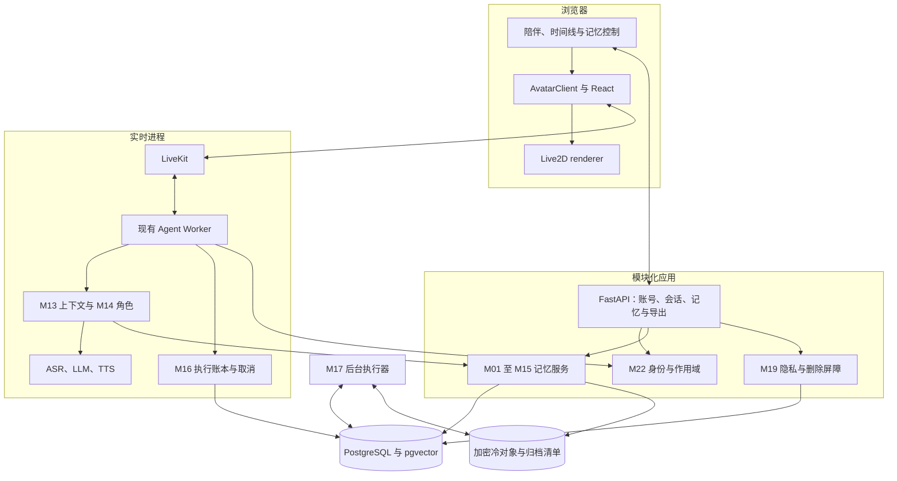
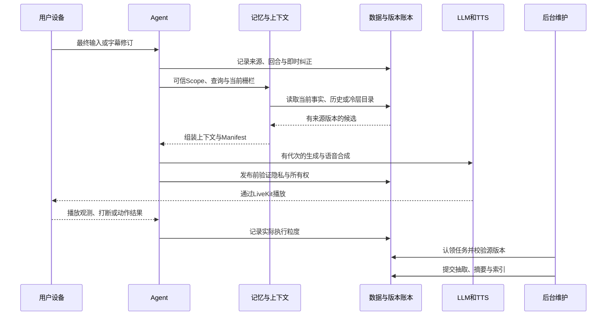
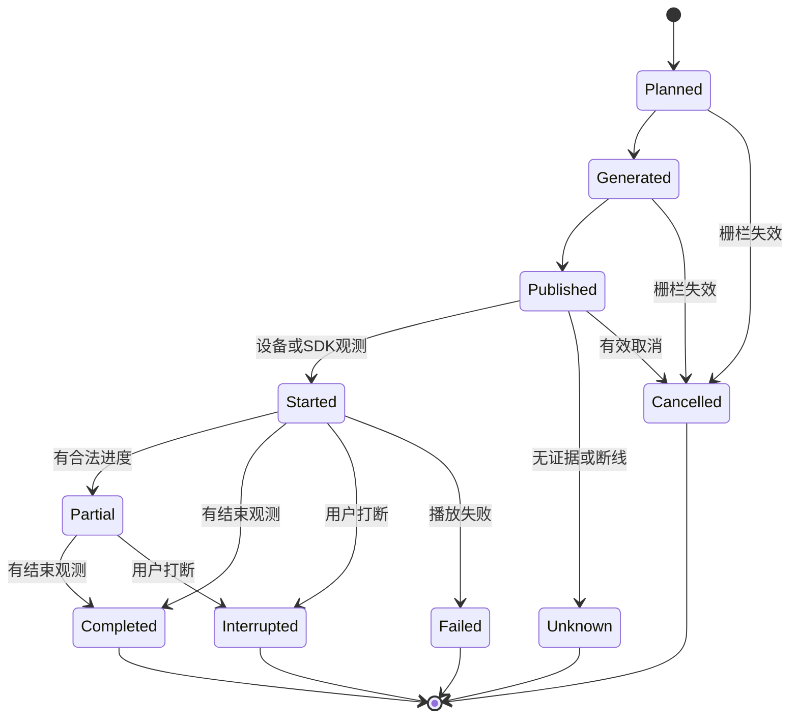
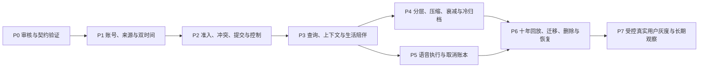

# AvatarWeave 十年以上生活陪伴数字人技术方案

版本：0.3 审核稿。更新日期：2026 年 11 月 3 日。状态：只完成设计文档，等待审核，未启动实现。

本项目聚焦能持续十年以上的语音生活陪伴：记住用户真正希望被记住的事情，理解经历、人物和关系随时间的变化，正确处理纠正、遗忘和隐私控制，并让记忆可靠地影响语音、表情与动作。以 Tolan 的公开体验和架构为参照，目标是在长期可追溯性、可控性和可演进性上形成可测量优势；“超越”需要对照与长期观察证明，不作为已经实现的结论。

本文与附件构成一份可供大模型分阶段开发的规范。所有算法、API、表、Pydantic 模型、参数和流程均为审核中的设计；除“现有基线”外不代表已实现。本轮仅修改 Markdown，不新增生产代码、迁移或依赖。

本版重点补齐三项工程约束：实时执行速度、并发下的资源隔离、负载下的记忆质量。新增 [性能、并发、新鲜度与质量联合验收规范](voice-memory-design/engineering-slo.md)；其中定义的负载、指标、分母、资源和取消规则为验收依据，不能仅凭单用户演示或模型 schema 检查判定达标。

## 1 本版范围与设计入口

### 1.1 唯一产品主线

首发面向成年用户的长期生活陪伴，围绕日常倾诉、共同经历、偏好、重要人物、人生事件、未来约定和自然回顾。语音为主，Live2D 是情感表达载体，受控歌舞作为后续表达能力。

正式长期记忆绑定可恢复账号；匿名仅提供临时体验，不用单个浏览器 cookie 承担十年关系。默认一个首发 companion，先证明关系连续性和用户控制，再扩角色。

本版不包含语言教学、任务评分、教材路径、商业支付重做、自动心理诊断或无限虚构世界。角色自己的虚构故事可用于表达，但与真实生活记忆严格分开。

### 1.2 文档分工

| 文档 | 内容 | 开发时用途 |
| --- | --- | --- |
| 本文 | 产品、十年目标、架构、容量、运行路径、验收、路线图 | 决定范围与关键边界。 |
| [生命周期算法](voice-memory-design/algorithms.md) | M01—M10 的原理、步骤、公式、失败和反例 | 按步骤实现写入与生命周期。 |
| [运行与长年维护算法](voice-memory-design/runtime-and-longevity.md) | M11—M26 的召回、实时、归档、迁移等细节 | 实现可运行、可恢复的长期系统。 |
| [模块与模型索引](voice-memory-design/README.md) | 每一模块的输入输出映射 | 发现并引用准确 BaseModel。 |
| [共享模型](voice-memory-design/contracts/00-common.md) | 严格类型、时间、来源、记忆、错误、版本栅栏 | 统一跨模块语义。 |
| [生命周期模型](voice-memory-design/contracts/01-lifecycle.md) | 准入到遗忘的输入输出 | 固定记忆写入、计划与提交边界。 |
| [召回与实时模型](voice-memory-design/contracts/02-recall-runtime.md) | 查询、上下文、角色、事项与输出 | 固定每轮交互链路。 |
| [长期操作模型](voice-memory-design/contracts/03-operations.md) | 身份、任务、归档、删除、迁移、导出与评估 | 固定十年维护和故障恢复边界。 |
| [HTTP 公开边界](voice-memory-design/contracts/04-http-boundary.md) | 浏览器输入与安全响应视图 | 避免将内部 Scope 与归档信息直接暴露。 |
| [联合验收规范](voice-memory-design/engineering-slo.md) | 在线执行、资源隔离、记忆可见性、固定负载与质量门槛 | 确保速度、并发和效果在同一条件下通过。 |
| [工程契约](voice-memory-design/contracts/05-engineering.md) | 容量清单、资源准入、取消、可见性查询和验收报告 | 将工程约束转换为明确字段与可验证结果。 |

Pydantic 定义只放在附件 Markdown 的 Python 代码块中，未转换为运行文件。所有模块统一返回 ModuleResult[具体输出]，错误与部分结果有明确结构。

### 1.3 主要选型

沿用 FastAPI、SQLAlchemy、LiveKit、现有 provider、Live2D 和 SDK；新增模块化记忆引擎、PostgreSQL + pgvector、持久任务进程和加密冷对象归档。不先引入 Kafka、Redis、图数据库或多套记忆框架。

关系图先用实体与有时间的关系表/索引实现；需要专用图存储时以查询证据和规模评审，不因出现“知识图谱”术语就新增基础设施。原始声音默认不长存，长期保留的是获准的结构化事实、必要证据胶囊和可重建视图。

## 2 十年设计要解决的问题

“十年记忆”不是把十年文本放进提示词，而是保证用户身份、事实版本、证据、检索入口和恢复能力能跨十年变化继续存在。

| 时间跨度问题 | 设计响应 | 不允许的捷径 |
| --- | --- | --- |
| 人改名、搬家、换工作、关系变化 | 稳定实体 ID、双时间、可重叠人生阶段 | 用名字作 ID，或最新一句覆盖全部历史。 |
| 多年没有提到一件重要往事 | pin、重要事件、冷热导航、历史查询取消近期偏置 | 权重低就物理删除。 |
| 摘要累计失真 | 原子事实与来源 DAG、强制覆盖检查、可按源重建 | 摘要反复摘要后当成新事实。 |
| 模型、向量和软件迭代 | 显式 schema/profile/index 版本与迁移回放 | 新旧向量混算、未知版本静默猜测。 |
| 用户撤回同意或要求忘记 | 删除栅栏、依赖清理、旧任务及备份防复活 | 只删在线向量，保留可检索旧归档。 |
| 设备丢失、换手机、认证服务更换 | 可恢复账号、内部稳定 user_id、可携带数据 | 匿名 cookie 被清除后按昵称找回。 |
| 长期成本与恢复风险 | 热温冷分层、增量作业、开放归档、校验与演练 | 每轮重读十年数据或只存供应商私有向量。 |
| 情绪与关系随生活发展 | 角色稳定、语气短期、关系证据更新 | 把一次心情固定成永久人格。 |

十年保存只覆盖用户允许保留且系统实际有证据的数据。完整原文按保留期清理后，不能承诺逐字重现；已有媒体是否被设备播放，也不能等同于用户听懂。

## 3 对 Tolan 的继承与本项目的改进目标

Tolan 公开案例披露了每轮重组上下文、最新输入加系统问题检索、后台记忆压缩去重和角色/语气分别控制。本项目以此作为基线思想，不宣称复刻未公开算法或当前全部生产配置。[公开技术案例](https://openai.com/index/tolan/)

| 基线思想 | 本项目明确实现 | 验证方向 |
| --- | --- | --- |
| 记忆影响持续对话 | 用户事实、共同经历、人物关系与未完成事项 | 跨日、跨年话题恢复与自然度。 |
| 每轮组装上下文 | 有预算的结构化分块、来源清单和版本栅栏 | 突然换话题、重复输入与误用旧记忆。 |
| 定期维护 | 证据锚定压缩、冲突与反思分开、增量水位 | 压缩保真、后台不会覆盖纠正。 |
| 人格稳定、语气适应 | 审核角色版本与短期语气状态 | 不因情绪变动失去角色身份。 |
| 低延迟语音 | 在线/后台分工、输出账本、取消与重连 | 真实手机语音、实际播放粒度。 |
| 长期可发展 | 十年冷检索、双时间、迁移、导出与防复活 | 十年回放和故障恢复，不只短会话演示。 |

右列是本项目待验证目标，不能据此判断 Tolan 没有同类能力。公开资料没有完整十年生产观察，故本项目也不以营销描述代替实证。

## 4 现有工程基线与边界

| 现有位置 | 当前事实 | 新方案接入 |
| --- | --- | --- |
| backend/avatarweave_agent/api.py | Token、目录、试听；可选共享 access key | 新增真正用户认证与受控会话入口。 |
| worker.py | Agent、动作工具、房间历史和会话事件 | 会话 Scope、每轮上下文、最终事件与输出账本。 |
| db.py | Conversation / Message，房间级消息 | 增量迁移、新记忆表；旧记录不自动归属某账号。 |
| pipeline.py 与 config/pipeline.yaml | provider/VAD/打断；当前开启预生成 | 先关闭记忆模式预生成，验证新栅栏后再启用。 |
| session_options.py | 严格 envelope 与 4096 字节上限 | 只传可信 session_ref，不塞入整份用户记忆。 |
| packages/core | LiveKit、转写、音频绑定、v1 动作 | 新协议能力声明、取消与观测适配。 |
| packages/renderer | Live2D、口型与动作执行 | 资源能力、开始/结束/取消回调。 |
| packages/react / apps/demo | React 集成与演示页 | 生活记忆页、时间线、账号与恢复体验。 |
| compose.yaml | LiveKit、可选 PostgreSQL 17 | 验证 pgvector 扩展、迁移、任务与对象存储部署。 |

现有动作 v1 无执行回执与精确语音同步，发送成功不能记成“已播放”。当前 API 的客户端 participant_identity、房间名和共享 key 不是最终用户认证依据。

本地 LiveKit 可见 on_user_turn_completed、update_chat_ctx、llm_node 和 interrupted 消息字段；具体顺序、文字路径、开场和预生成行为须在 P0 核实。[现有架构](architecture.md)、[协议](protocol.md)、[维护约定](maintenance.md)。

## 5 产品架构与长期体验

### 5.1 产品架构图

### 5.2 用户体验约定

- 首次进入可临时体验；保存正式长期记忆前完成账号与记忆选择，明确完整转写和来源胶囊的不同保留范围。
- 对话支持字幕修订、打断、暂停、继续与“不要记住这次”。无证据时自然澄清，不装作一直记得。
- 记忆页按事实、偏好、共同经历、重要人物、未来意图组织；推断标为推测，虚构角色故事另列。
- 时间线支持过去阶段与当前状态并存。展示“你当时说过”要有对应来源，来源全文已到期则不提供伪逐字回放。
- 用户决定哪些事情值得保留、是否允许追问或纪念回顾；悲伤或私密往事不因“重要”就自动提起。
- 关系通过真实互动逐步延续，不以制造情感依赖、虚构共同经历或无限加深亲密度为目标。
- 不记忆会话不持久正文及其派生，不承诺断线后恢复该段原文。第三方模型处理边界独立说明。

## 6 技术架构与进程部署

首期 API、Agent、后台作业是独立进程但复用同一业务包；图中连接不强制拆为远程微服务。每个进程独立管理数据库会话，单个有效 Worker 用 owner_epoch 与租约隔离。

PostgreSQL 保存身份、当前事实、来源关系、摘要导航、目录、水位与删除状态；大体量冷数据加密归档。SQLite 保留原演示与单元测试用途，完整记忆功能以真实 PostgreSQL 验收。

归档与备份不是一回事：归档是仍可检索的长期资料，备份是故障恢复副本；两者都遵守当前授权和删除账本。

## 7 记忆模型、时间与来源

### 7.1 正交维度

内容类型：事实、偏好、事件、关系、未来意图、互动偏好和反思。独立属性包括：冷热层级、敏感性、模态、事实/推断、证据粒度与时间精度。

namespace 仅使用 life、relationship、character_lore。前两者是现实生活和真实互动，后者只能是人工/明确标记的虚构设定。跨 companion 默认不共享关系经历；用户允许共享的生活谓词才进入白名单。

### 7.2 双时间与不可变修订

每条事实记录现实有效区间与系统知晓区间。纠正创建新版本，按适用范围撤销错误认知；搬家创建新生活阶段，不删除旧住址历史。姓名、账号邮箱和渲染形象变化均不改变人物/用户的稳定 ID。

同一事实键的并发由事务与版本校验控制；模型不直接执行更新。source revision、memory_revision、privacy_epoch、owner_epoch、generation_id 分别承担来源、事实、删除/授权、进程所有权和输出计划的不同栅栏，不能混成一个递增值。

### 7.3 来源与证据胶囊

原始转写默认 90 天、可配置；长期事实与必要来源片段在用户允许下保留。EvidenceCapsule 保存最少原话、原事件位置、时间、修订、授权与校验信息，不等于完整录音或聊天。

摘要与画像是派生视图，依赖 DAG 可追溯到原子事实/胶囊。源被纠正或删除时，派生视图失效再重建。无合法原文或胶囊时不能生成“原话引用”；证据粒度如实降低。

实体、版本和关系用关系表实现；具体字段和严格类型见 [共享契约](voice-memory-design/contracts/00-common.md)。

## 8 模块划分与输入输出规范

完整 [模块输入输出表](voice-memory-design/README.md) 为开发入口，共 M01—M26；其中 M22、M23 各有两个子入口。每个入口都有明确 BaseModel 输入和输出 data，没有以裸 dict 作为替代的业务载荷。

| 分组 | 模块 | 原理与实现步骤 | BaseModel |
| --- | --- | --- | --- |
| 形成 | M01 准入、M02 实体、M03 时间、M04 冲突、M05 提交 | [生命周期算法](voice-memory-design/algorithms.md) | [01](voice-memory-design/contracts/01-lifecycle.md) |
| 维护 | M06 分层、M07 压缩、M08 反思、M09 衰减、M10 遗忘 | [生命周期算法](voice-memory-design/algorithms.md) | [01](voice-memory-design/contracts/01-lifecycle.md) |
| 每轮交互 | M11 查询、M12 召回、M13 上下文、M14 角色、M15 事项、M16 执行 | [运行算法](voice-memory-design/runtime-and-longevity.md) | [02](voice-memory-design/contracts/02-recall-runtime.md) |
| 可靠运行 | M17 任务、M18 归档、M19 删除、M20 迁移、M21 评估 | [运行算法](voice-memory-design/runtime-and-longevity.md) | [03](voice-memory-design/contracts/03-operations.md) |
| 基础适配 | M22 身份会话、M23 输入网关、M24 向量、M25 携带、M26 存储 | [运行算法](voice-memory-design/runtime-and-longevity.md) | [02](voice-memory-design/contracts/02-recall-runtime.md)、[03](voice-memory-design/contracts/03-operations.md) |

模块只返回提案或计划时必须在类型与状态中标明，不能声称已落库、已归档或已播放。Pydantic 负责形状与部分不变量；来源真实性、权限、引用、事务和语义核验由服务负责。

拟议目录：identity、sessions、memory、conversation、jobs、archive、privacy、migration、evaluation。现有 provider 与 renderer 边界保持，不把业务记忆写入厂商插件。

## 9 关键算法总览

细节包括计算公式、参数、步骤、失败和反例，见 [M01—M10](voice-memory-design/algorithms.md)。这里概括主原理，不能仅按本节概括直接实现。

### 9.1 分层是位置管理，不是事实管理

工作上下文与 hot/warm/cold 分开；原子事实与会话/月/年/人生阶段摘要的抽象层级也分开。默认近期 30 天 hot、31—365 天 warm、更久为 cold 候选，但 pin、重要边界和活跃事项可保留热层。

迁移先写冷层、回读验真、切 manifest，再撤在线副本。冷层仍可被实体、时间、关键词与摘要导航找回，不代表遗忘。容量超额时迁移与报警，不静默删保护记忆。

### 9.2 压缩是受保护事实清单与来源索引

先提取原子事实与时间条件，标记 mandatory（pin、否定、纠正、重要事件、边界和未完成事项），再在 token 预算内选择信息，生成逐项引用来源的 SummaryClaim。

以保留价值最大化为目标，mandatory coverage 必须为 1；无依据结论必须为 0。预算不够拆摘要页，不丢 mandatory。摘要 DAG 保留叶记录路径，源变化后重建，不无限无校验地“摘要的摘要”。

### 9.3 反思只产生可撤销假设

至少多个独立会话、跨日期的支持，去除复制来源，并主动查反例。输出 model_hypothesis 与复核时间；用户确认才生成有新确认来源的事实版本。画像本身是当前合法事实的视图，不是另一套秘密人格判决。

### 9.4 衰减是优先级，不是真实性

freshness = floor + (1-floor) × 2^(-age_days/h_eff)。

h_eff 随独立用户确认有限增大，机器自己检索/复述不算强化。瞬时情绪、日常事件、偏好、重大事件使用不同半衰期；pin 不按时间降权。明确历史查询不使用近期偏置，十年前的记忆可以优先于昨天的相似事件。

### 9.5 遗忘必须区分动作

降权、归档、事实失效、派生视图失效、保留期删除、用户删除是六项不同操作。不得以低权重自动物理删除生活记忆。用户删除覆盖相关派生与归档，pin 不能阻止删除。

### 9.6 冲突是实体、条件、时间与证据比较

先用注册的 single/set/event 谓词和条件构建事实键；判断重复支持、条件共存、时间变化、矛盾或不确定。用户明确纠正优先于旧推断，歧义请求确认，不简单按最新文本覆盖。

提交时重验目标版本、来源与授权，在事务中拆/改有效区间并创建新修订。撤销错误认知与真实生活变化分开，不能把“我从没住过那里”写成“过去曾住那里”。

## 10 每轮语音闭环与生成栅栏

不记忆模式不执行含正文的持久化分支，只在本次会话内组装；此时不承诺断线后恢复正文。

首版关闭记忆会话的预生成。后续启用时，输入 revision、memory_revision、privacy_epoch、owner_epoch 与 generation_id 全匹配才可发布。语音、文字、主动开场都经过同一上下文与栅栏。

明确 UI 纠正先短事务提交事实与失效屏障，再更新覆盖层；向量异步完成前仍可从覆盖层/关键词查到。语音纠正若仍有歧义，先持久化来源与待核验状态，下一轮不使用命中的疑似过时字段作确定结论；需要模型推理或澄清时走异步，不能谎称已更新画像。数据库写入失败不显示“已记住”。

普通对话只等待必要授权、短输入事务、近期覆盖层、有界检索和上下文，不等待完整抽取、压缩、反思、归档、额外语气模型或模型重排。普通路径额外模型生成调用默认 0；query embedding 合批，独立通道在资源额度内并行。完整顺序、分项预算与降级规则见 [联合验收规范第 1 节](voice-memory-design/engineering-slo.md)。

## 11 长期检索与上下文

[具体步骤与排序公式见 M11—M13](voice-memory-design/runtime-and-longevity.md)。

先在授权域内查询事实键、实体、关键词、同模型向量、时间与事项，使用带名次的 RRF 融合，不直接相加异构原始分数。普通路径默认三个查询、每通道 20 条、合并 60、选入最多 8；独立分支受信号量和父请求 deadline 约束。单会话 DB 池为 1 时 SQL 短占用顺序执行，不能假装同会话所有 SQL 也已并行。

当前问题使用当前有效事实；历史问题按现实时间查合法旧阶段；问当时认知才使用 system time。已删除内容无论哪种历史问题都不能读取。

冷层先通过人物/时间目录与月年摘要定位，再读少量加密片段局部检索。每次最多四片、8 MiB，超过在线预算则异步/分页，并允许澄清。冷层没查完不等于没有该事件，返回 partial 状态，不能生成确定否定。

上下文分为系统、角色、语气、画像、近期消息、动态记忆、事项、运行状态与当前输入；普通路径在 6000 token 起始预算内选择，记忆约 1200、摘要约 800。明确多事件历史回顾可使用 10000/3000 tokens、最多 16 条，复杂跨年组合可使用 16000/5000、最多 24 条，转入单独限额与时限的 deep_recall。规则、当前输入、明确纠正与完整工具组优先，不固定裁成八条破坏必要证据。

来源刚持久但结构化/索引未完成时，新会话可读取获准的来源增量与 processing 状态，不能把索引缺失解释成“从未说过”。使用 MemoryVisibility 的连续 settled 水位与目标事件状态，明确 provisional 内容不是最终画像。

Manifest 记录记忆版本、选入/排除原因、输入水位、预算和裁剪，不默认重复保存整个私人提示词。检索到的东西可以只隐式用于改善语气或选择，不一定主动复述。

## 12 十年以上容量、成本与增量维护

### 12.1 容量估算

下列为容量假设，不是已测用户行为。按十年 3653 天、每天 5000 个中文字符、每字约 3 UTF-8 字节、1024 维 float32 向量估算，不计副本、行开销和索引：

| 假设 | 十年数量或原始体积 | 工程含义 |
| --- | --- | --- |
| 完整转写保留十年 | 约 54.8 MB/用户 | 体积不是唯一问题，隐私与可检索性更重要；默认不如此保留。 |
| 每天保留 40 条原子记忆 | 146120 条/用户 | 仅向量约 598.5 MB/用户。 |
| 每天保留 200 条原子记忆 | 730600 条/用户 | 仅向量约 2.99 GB/用户。 |
| 一万用户、每人 40 条/天 | 约 14.61 亿条十年记录 | 仅向量约 5.99 TB，实际还有存储和索引开销。 |
| 每人在线只保留两万条向量 | 原始向量约 81.92 MB/用户 | 是初始软预算，不是每人人生记忆条数上限。 |

40/200 是长期保留后的数量假设，不是每句都抽取。应通过准入、严格去重、分层、摘要导航与冷层减少在线成本，不能为了压低容量悄悄删人生经历。

### 12.2 增量机制

每用户维护 input_watermark、memory_revision、dirty refs、摘要依赖和作业游标。新输入只抽取新增片段；事实变化只使受影响摘要/索引失效；月/年维护基于增量与叶来源验证，不对十年每轮全量调用模型。

热门人物与事项可保留快速目录，冷数据按时间和实体定位。向量 profile 重建按批次与配额，优先活跃与关键记录，再覆盖冷层；不会因换 embedding 模型阻塞全部生活对话。

### 12.3 时间跨度保障

年限设计靠时钟推进、事件回放、数据迁移、删除和恢复演练验证；真实长期自然度与关系质量仍需真实使用持续观察。合成十年数据不是十年实证，也不能用短期高分保证未来模型永不出错。

## 13 身份、账号恢复与作用域

长期保存必须有稳定内部 user_id 与可恢复账号；匿名体验标为短期，不自动成为正式长期记忆。OIDC 认证验证由成熟库完成，provider 更换或邮箱变化不改变内部用户主键。具体认证服务和账号恢复流程在审核时锁定。

恢复或匿名升级要求相应账号凭据，不按名字、声音或亲友关系推断所有权。跨设备恢复读取同一用户/companion 的数据，房间是短期传输容器，不是记忆所有者。

产品入口由服务端创建 session_ref、room、participant 和 dispatch，Worker 读可信绑定校验。现有 demo Token 接口不得加入私人房间；共享 access key 不放公开前端。作用域限制在 SQL 内执行，数据使用和输出前再次核验。

账号生命周期、独立 companion 关系与导出迁移见 [M22/M25](voice-memory-design/runtime-and-longevity.md)。

## 14 隐私、遗忘与恢复防复活

[完整删除流程与输入输出见 M19](voice-memory-design/runtime-and-longevity.md)、[PrivacyInput/Output](voice-memory-design/contracts/03-operations.md)。

删除首先事务撤销可见性、提升 privacy_epoch，再清理依赖图、摘要、反思、向量、缓存、导出和冷对象。混合摘要整体失效后从合法源重建；cold 先读屏障、再物理重写对象。

每个后台提交、检索结果使用、索引切换、备份恢复与导入都检查当前删除账本。旧任务和旧摘要不能重新抽取被删记忆，恢复环境重放删除状态前不能开放读取。

原始转写、来源胶囊、结构化事实、摘要、音频和技术指标保留策略分别告知；不记忆模式无持久正文载荷。账号删除、单条删除、时间范围删除和“今后不再记住”范围不同，确认 UI 不允许模糊推断。

删除响应区分“已逻辑撤销”和“物理清理完成”，在途已经播放的内容无法撤回。备份有明确到期时间，tombstone 不存被删正文。

## 15 语音、动作、歌舞与执行账本

现有 avatarweave.command.v1 不改语义。新增有状态动作拟用 command.v2 与独立 receipt.v1，按明确能力声明启用，不猜协议、不双发、不以可靠传输代替完成。

媒体/设备进度能证明到哪一级，就记录到哪一级。没有可靠文字-音频对齐时 safe_spoken_prefix=None，不能按播放时长线性猜用户听到了几个字。completed 也不意味着用户理解。

打断取消同 generation 的音频、动作和旧候选；误打断恢复须重新校验。重连不重复表演或开场，旧 Worker 不得发布新输出。

歌舞后续使用授权素材目录、独立演唱/媒体适配器与统一输出互斥；普通 TTS 不默认会唱歌。真实完成的一次互动才可形成共同经历，计划和工具返回值不是事实。

## 16 可靠任务、迁移与可携带性

持久 outbox 与业务事件同事务；Job 用租约、幂等键和有限重试，至少一次执行但业务提交不重复生效。失效任务 obsolete，永久错误进入 dead，不无限模型修复。[M17](voice-memory-design/runtime-and-longevity.md)

归档 staged→verified→active：回读验证 checksum、条数、版本、授权和删除状态才可撤在线副本。归档对象和密钥都可恢复才算恢复成功；定期抽样、季度隔离演练。[M18](voice-memory-design/runtime-and-longevity.md)

schema、embedding、归档格式与密钥轮换显式版本化。新空间复制、校验、回放、审核再切换，旧索引不与新向量混算；备份恢复先删除账本后公开读取。[M20](voice-memory-design/runtime-and-longevity.md)

导出开放 schema 的事实、事件、时间、来源与摘要依赖，原始全文仅在仍合法存在且用户要求时包含。导入 dry-run、重映射 ID、检查冲突与删除状态，不让旧包静默复活用户已删内容。[M25](voice-memory-design/runtime-and-longevity.md)

## 17 数据落库与 API 对应

### 17.1 数据实体

User/AuthSession、Companion/PersonaVersion、UserSession/Turn/SourceEvent、MemoryItem/MemoryRevision、Entity/Alias/TemporalRelation、EvidenceCapsule/DerivedDependency、Summary/ProfileView、OpenLoop、EmbeddingProfile/MemoryEmbedding、ContextManifest、Output/Observation、Job/Outbox、ArchiveManifest、PrivacyControl/Tombstone/DeletionJob、Migration/ExportManifest。

这些是拟议数据库边界，Pydantic 是服务 DTO，不直接作为 ORM。迁移需逐步引入、版本化；不对旧房间消息凭空补 user_id。正式 SQL schema 应保持契约语义和关键约束。

### 17.2 产品 API

所有作用域、RequestMeta 与 Fence 从服务端获取，不能让调用者自行填写可信内部字段。

| API | 关联模块与 DTO | 必须语义 |
| --- | --- | --- |
| 认证回调、匿名体验、账号恢复 | M22 IdentityInput/Output | 凭据不入普通日志；正式长期保存需要账号证明。 |
| POST /api/v2/sessions 与 resume/end | M22 SessionInput/Output | 服务端房间、唯一有效 owner、幂等恢复。 |
| 输入修订与字幕纠正 | M23 InputEventInput/Output | 新 source revision 使旧候选失效。 |
| GET /api/v2/sessions/{id}/memory-status | M23/M26 VisibilityReadInput/Output 的公开投影 | 逐目标事件区分来源持久、结构化、索引与待确认，不只返回模糊成功。 |
| GET /api/v2/memories 与 /timeline | M26 RepositoryInput/Output 的公开投影 | 分页、当前用户、证据粒度，不暴露对象密钥。 |
| PATCH /api/v2/memories/{id} | M01/M04/M05 控制流水线 | expected_version、原话与纠正依据、下一轮生效。 |
| DELETE /api/v2/memories/{id} | M19 PrivacyInput/Output | 先撤可见性，返回删除任务进度。 |
| PUT /api/v2/memory-preferences | M19 PrivacyPreference | 区分今后记忆、原文与胶囊保留。 |
| GET/PATCH /api/v2/open-loops | M15 OpenLoopInput/Output | 不推断结果，不自动创建推送。 |
| POST /api/v2/exports 与 imports/dry-run | M25 ExportInput/Output | 有限授权、合法来源、恢复确认与防复活。 |
| GET /api/v2/deletion-jobs/{id} | M19 PrivacyOutput | 只见自己的清理状态与范围。 |

公开读取投影不可直接泄露 MemoryRecord 中私有 scope、内部归档位置和来源正文。[HTTP 公开边界模型](voice-memory-design/contracts/04-http-boundary.md) 已定义浏览器 body、分页与响应视图；实施阶段从这些模型生成 OpenAPI 并冻结序列化。不能直接把内部 Request 暴露到浏览器当鉴权。

## 18 配置、错误、性能与故障行为

### 18.1 参数与版本

分层、衰减、压缩、召回、原文保留、并发和作业预算均使用版本化策略。示例参数已固化在对应 Policy BaseModel；不同记忆类别的 policy 由服务端 predicate/content registry 选择，不让模型临时自选。

改算法权重或模型版本需固定回放对照，记录生效批次。用户授权、账号凭证和 provider 密钥不作为可公开配置。生产环境 CUDA/端点继续沿用原工程边界。

内部 RequestMeta.schema_version 在 v0.3 升至 2，新增必需 ExecutionControl；它与 RTC/动作/来源的独立协议版本不同。未知内部 schema 明确拒绝，不默认补无限预算。工程策略的完整定义以 [联合验收规范](voice-memory-design/engineering-slo.md) 为准。

### 18.2 性能初始目标

| 指标 | 初始设计目标 | 验证边界 |
| --- | --- | --- |
| 正常语音结束到实际播放 | P50 ≤1.5 秒，P95 ≤2.5 秒 | 实际网络/设备/供应商固定，冷启动单列。 |
| 普通记忆准备 | P95 ≤200 ms，deadline 300 ms | 含资源等待、短来源提交、query embedding、检索和组装，不只报 SQL。 |
| warm 多事件回顾 | 实质答案 P95 ≤5 秒起始目标 | 单独路径与资源限额，不用进度话术计作最终答案。 |
| 冷层回顾 | 实质答案 P95 ≤10 秒起始目标，超时转 partial | 四片/8 MiB 起点；报告完整回答率，不伪装成全冷层即时读取。 |
| 显式纠正 | 成功提交后的下一最终回合 | 使用水位与覆盖层，不等异步向量。 |
| 删除可读性 | 撤销事务后新读不返回 | 老快照与输出提交仍校验 epoch。 |
| 热层到冷层 | 迁移校验失败不撤唯一副本 | 真实对象读写与中断验证。 |

初始目标不是现有成绩；总 P95 不能通过各阶段 P95 相加获得。若不达标先定位供应商与管线，不跳过来源或权限核验。

300 ms 仅约束记忆准备子调用，不约束整个主 LLM/TTS。首个实质音频根 hard deadline 起点为普通 4s、warm 8s、cold 15s，仍需达到表中的更严格 P95；开始播放后进入独立有界流阶段（总长 30s、空闲 5s 起点），继续继承取消/隐私/代次，不能无限后台续跑。

### 18.3 错误与故障

所有模块使用 ErrorInfo。检索超时只使用可靠近期信息并澄清；抽取失败不写 active；数据库失败不假装保存；播放回执缺失 unknown；归档损坏返回可恢复错误，不让模型补故事。

观测关联 trace/session/turn/generation/ref/version/epoch，记录阶段耗时、成本、选择原因与失败环节。普通日志不记录完整原文、提示、凭据或音频。受限内容诊断必须有授权与有限保留。

灰度分别控制读、写、查询扩展、上下文、维护和新输出协议，删除控制始终有效。回滚不删新数据、不恢复用户已删来源。

### 18.4 并发与执行硬边界

数据库连接预算按所有 API、Agent 子进程、后台和迁移实例求和，初始上限为 max_connections 的 70%；不是每个进程各自占用完整配额。在线/control 与后台分池和配额，仍需验证共用 CPU、I/O、GPU 与供应商账号的干扰。

模型/embedding/对象 I/O 不在持锁事务中执行，事实锁限定必要键且固定顺序；不在整个推理期间锁住用户 memory_revision。CPU 重任务使用有界独立执行资源，实时事件循环不执行无界压缩或解析。若用现有 Kokoro，短句推理锁造成的排队必须单独压测。

每会话最多一个有效 generation、每用户同时运行会话初始上限 2；每轮检索分支上限 4。队列按条数、字节、最老年龄与每用户占用设上限，control/dialogue 有保留额度，超额明确 overloaded/retry_after。禁止用无界 outbox 伪装有界队列。

父 deadline 使用单调时钟传递；超时/打断/隐私变更后取消 I/O并回收槽与连接。不能强制终止的本地推理保持有限 detached 槽、丢弃失效结果，实际结束后才释放。接口返回不代表后台工作已停止。

### 18.5 记忆新鲜度与成功语义

| 状态 | 初始门槛或行为 |
| --- | --- |
| 最终来源持久确认 | P95 ≤100 ms，含排队/池等待。 |
| 本会话可用 | 下一有效回合读取新原话/纠正，未判定内容保留 provisional 标记。 |
| 明确 UI 纠正/删除逻辑撤销 | P95 ≤300 ms；成功后新读取遵守新版本。 |
| 普通来源结构化 settled | P95 ≤5 秒、P99 ≤15 秒，含后台队列。 |
| 普通向量索引 settled | P95 ≤10 秒、P99 ≤30 秒，从来源持久起算。 |
| 跨会话刚提交记录 | P95 ≤300 ms 可见来源/处理状态，不谎称已经完成索引。 |

水位表示连续已处理前缀，不用最大完成序号跳过中间洞；拒绝保留的输入也可处理完成，但水位不证明每句话都被存为事实。“收到”“已保存记录”“已更新记忆”“正在整理”分别绑定不同提交证据。完整异常口径和目标事件查询见 [第 3 节](voice-memory-design/engineering-slo.md)。

## 19 验收、对照与十年回放

[评估算法 M21](voice-memory-design/runtime-and-longevity.md) 与 [EvaluationInput/Output](voice-memory-design/contracts/03-operations.md) 规定独立数据集版本、时钟和失败归因。

| 验收组 | 场景与不可破坏条件 |
| --- | --- |
| T01 身份 | 账号换设备可恢复；别人的昵称/声音/房间不能授权；匿名不冒充十年身份。 |
| T02 事实与时间 | A→B→A、过去纠错、条件共存、集合偏好、日期不明与不同系统认知。 |
| T03 分层与冷查 | 十年旧事、pin、稀有人名、归档中断与按需提升，不以低优先级删内容。 |
| T04 压缩 | mandatory coverage=1、无无依据结论、否定/时间/来源不丢；失败保留旧视图。 |
| T05 反思与衰减 | 反例可撤销、自我复述不强化、瞬时情绪不固化、历史查询无近期压制。 |
| T06 纠错与删除 | 下一轮使用新事实；摘要、归档、导出、旧任务和恢复不复活删除。 |
| T07 语音执行 | 打断、误打断、字幕修订、重连、旧 Worker 和无回执均不伪造完成。 |
| T08 长年演进 | schema/模型/密钥/归档迁移与断电恢复，checksum 合法且无跨用户泄露。 |
| T09 隐私 | 不记忆模式无持久正文；原始全文到期后不伪造逐字引用。 |
| T10 容量与成本 | 十年规模分布下的目录、热冷命中、后台积压与各年每用户成本。 |

构建至少 100 个先验清晰的基础案例，逐步扩至十年事件图；使用模拟时钟推进日/月/年，注入事实变化、缺失来源、迁移与删除。合成与真实脱敏样本分别报告。

对照组：近期窗口、普通向量 RAG、双时间/混合检索/上下文、完整长期系统。固定基础模型和预算，逐模块消融。语气、自然度、被理解感与控制感使用盲评和真实用户反馈，不用单一 LLM 自评替代。

可参考 [LongMemEval](https://arxiv.org/abs/2410.10813) 的信息抽取、跨会话/时间推理、更新与拒答能力，以及 [LoCoMo](https://arxiv.org/abs/2402.17753) 的长期对话评估；外部基准不等同本项目十年生产验证。

后续代码验收使用原 npm/backend/schema/config 检查，并增加真实 PostgreSQL、对象归档、任务故障与浏览器语音回归；不得用 mock 文字通过代替实际语音证据。

### 19.1 v0.3 质量与联合验收关口

100 个基础案例只用于开发回归；上线 held-out 至少 1000 个跨会话问题、关键分组各至少 100 个，并另有身份/删除/幂等并发故障集。指标必须报告分子、分母、置信区间和失败样本。

建议初始门槛：写入精确率 ≥98%，重要信息保留召回 ≥95%，必要证据完整率 ≥95%，时间/更新回答正确率 ≥95%，有依据回答正确率 ≥95%，无依据个人断言率 ≤1%，正确澄清 ≥95%，可回答题过度拒答 ≤5%。accepted 压缩 mandatory coverage=100%；越权/删除复活/取消后动作重放在测试中均为 0，任一次即阻断发布。完整定义、关键分组门槛和压缩人审要求见 [联合验收规范第 5 节](voice-memory-design/engineering-slo.md)，不能只执行本段摘要。

容量建议档：L1 为 10 活跃语音会话/1 轮每秒，L2 为 50/5，L3 为 100/10。P0 冻结首发目标和 CapacityManifest；仅对完整通过的档位声明容量。每档三次运行，后台抽取、索引、压缩与归档同时开启，覆盖正常、2 倍突发、故障和恢复。

同一负载同时满足绝对延迟、资源/队列有界、新鲜度和质量；后台开启或单个慢用户下，其他普通请求 P95 增幅≤20%且仍满足绝对门槛。正常稳态拒绝率/系统错误率各≤1%、降级率≤5%；所有超时、拒绝、未完成必须统计，不能排除后只报成功样本。完整运行时间和过载恢复规则见 [第 6 节](voice-memory-design/engineering-slo.md)。

禁止通过停用记忆、过度拒答、削减必要证据、隐藏冷层未完成、把进度语句当最终答案或无限后台继续跑来“达标”。阈值为待审核工程要求，尚未实测通过。

## 20 实现路线图与大模型开发任务

### 20.1 工程路线图

| 阶段 | 模块与交付 | 验收门槛 |
| --- | --- | --- |
| P0 | 本文审核；冻结 schema/算法、CapacityManifest、负载档和 held-out；验证 hooks、播放、认证与供应商容量 | ADR、池总量/配额计算、普通/深查路径与超时策略明确；只在审核后进行实现验证。 |
| P1 | M22/M23/M26；账号、来源、双时间、短事务、源水位与处理状态 | T01/T09；连接数预算、来源确认与跨会话状态读取通过；旧历史不自动认领。 |
| P2 | M01—M05/M19 基础；纠正、删除屏障与记忆页 | T02/T06/T09；明确控制时限、待确认语义、下一轮可见性与无假保存通过。 |
| P3 | M11—M15/M24；并行有界召回、上下文、角色与取消传播 | 普通路径延迟和 L1 基础负载；新鲜度、证据召回、上下文质量与超时释放同时满足。 |
| P4 | M06—M10/M17/M18；有界队列、后台配额、压缩、衰减和归档 | T03—T05；后台干扰、队列公平、积压排空、accepted 压缩质量与冷查通过。 |
| P5 | M16；协议、实际执行、取消与重连 | T07；真实 TTS容量、迟到结果、detached槽回收与其他用户不被拖住通过。 |
| P6 | M20/M21/M25 与完整 M19；迁移、恢复、联合压力和十年评估 | T06/T08/T10 及完整 JointAcceptanceReport；固定容量档三次速度/并发/质量同时通过。 |
| P7 | 按已通过容量灰度、观测与成本/长期体验 | 不超出经验证档位承诺；超载有界、可回退、真实长期结果持续积累。 |

单执行者可顺序 P0→P1→P2→P3→P4→P5→P6→P7；P4/P5 只是依赖上可独立，不要求并行代理。不给未经人力与 P0 估算的固定交付日期。

### 20.2 每个模型开发任务必须提供

任务编号、对应 M/P/T、输入输出 BaseModel、ExecutionControl/资源通道、来源可信度、算法步骤与版本、允许修改路径、锁与事务范围、deadline/取消/队列行为、可见性承诺、质量指标、验收案例、实际检查与回滚方式。任务粒度以一个可审查闭环为单位，不“一次实现全部十年记忆”。

优先顺序：契约和测试案例→最小业务闭环→状态与故障→性能→灰度。不得用模型自报的权重、完成状态或来源校验替代实际实现。

禁止：越权 Scope、裸 dict 逃避 schema、所有用户共库后只用提示词隔离、向量混空间、低权重删人生事实、无来源压缩、后台吞错、发送即完成、旧版本静默猜测、修改受保护 provider、擅自生产迁移或部署。

每阶段报告修改文件、契约变化、完成验收组、检查真实结果、未验证语音/归档边界、成本与限制。只在 Markdown 出现的设计不得标已实现。

## 21 审核清单

| 决策 | 本版推荐值 | 审核影响 |
| --- | --- | --- |
| 产品范围 | 成年用户长期生活陪伴 | 本方案图、接口、路线图都仅围绕此范围。 |
| 十年正式身份 | 可恢复账号；匿名临时体验 | 需选择认证与恢复方案，不能再依赖单 cookie。 |
| 事实与证据保留 | 原文默认 90 天；胶囊与结构化长期保留需用户允许 | 决定精确回忆粒度、隐私与实际成本。 |
| 分层 | 30/365 天起点，pin 和重要事件受保护 | 参数可调，迁移不等于遗忘。 |
| 压缩 | 来源锚定，mandatory 全覆盖，失败不覆盖 | 比纯摘要多验证成本，但减少多年累积漂移。 |
| 遗忘 | 不以衰减自动删除生活事实 | 用户删除与显式保留政策优先。 |
| 冷存储 | 加密对象、开放格式、目录与定期恢复 | 需确认存储、密钥托管、备份和成本责任。 |
| 真实超越指标 | 十年可追溯、纠错、防复活和陪伴体验 | 以对照和真实观察证明，不预先宣称优于竞品。 |
| 工程目标与容量 | 固定清单和负载下速度、并发与质量同时过关 | 不能独立报最快延迟或只测空库；采用联合验收规范。 |
| 新鲜度和过载 | 明确来源/结构化/索引状态，有界等待和公平配额 | 用户不被误报保存成功，慢用户与后台不拖住他人。 |
| 当前交付 | 审核稿与 Pydantic 文档定义 | 尚未授权创建生产实现或部署。 |

建议先审第 1、2、5、12、21 节，再审算法附件 M04/M06—M10/M12/M18—M20，最后逐模块核对输入输出与反例。确认设计后才进入 P0 实施验证。

## 22 资料与来源

### 本地工程

[架构](architecture.md)、[协议](protocol.md)、[扩展](extending.md)、[维护](maintenance.md)、[记忆知识体系](../数字人智能体记忆知识体系.md)。旧业务文件不作为本版需求输入，不自动修改。

### 公开一手资料

- [Tolan 技术案例](https://openai.com/index/tolan/)：每轮上下文、检索式记忆、后台维护和人格表达的公开参考。
- [Portola 创始人介绍](https://www.tolans.com/relay/introducing-tolan)：生活陪伴与共同经历的产品方向。
- [MemGPT](https://arxiv.org/abs/2310.08560)：分层和有限上下文管理的研究背景，不直接规定本项目冷热参数。
- [Generative Agents](https://arxiv.org/abs/2304.03442)：检索、反思与行为生成研究背景；本项目公式是可验证工程基线，不冒充原论文原样实现。
- [LongMemEval](https://arxiv.org/abs/2410.10813)、[LoCoMo](https://arxiv.org/abs/2402.17753)：长期交互评估参考。
- [LiveKit nodes/hooks](https://docs.livekit.io/agents/logic/nodes/)、[RAG](https://docs.livekit.io/agents/logic/external-data/)、[turns](https://docs.livekit.io/agents/logic/turns/)：管线接入，以实际安装版本验证。
- [pgvector](https://github.com/pgvector/pgvector)：向量与索引能力，版本/维度限制需在实施时核查。
- [Pydantic Models](https://docs.pydantic.dev/latest/concepts/models/)、[严格模式](https://docs.pydantic.dev/latest/concepts/strict_mode/)：模型定义与校验语义。

## 23 2026-11-05 日常陪伴实现排查记录

本节描述当前代码排查和增量修复，不改变前文设计目标，也不代表工业级验收已完成。参考《数字人智能体记忆知识体系.md》的写入、检索、工作上下文与故障归因闭环。

已定位并修复的缺口：

- 泛化的“你记住了什么”没有生活类别检索入口；新增偏好、关系、经历、计划的确定性类别路由，概览按类别保留候选和上下文位置，避免最近单一话题占满预算。
- 没有显式日期的人生回顾不会开启历史读取；此类查询现在设置 reminisce，允许读取过去有效阶段。仍遵守来源、当前系统版本和删除限制。
- 对话上下文只传 display_text，可能遗漏限定条件；现在同时传 canonical_value、qualifiers 和原始时间表达，保留否定、主体与证据使用限制。
- 提取提示缺少生活信息覆盖要求；补充多类事实分别提取、日常经历、厌恶与条件偏好、人物关系，以及过去阶段不冒充当前状态的规则。提示改动的效果仍需真实模型验证。

后续自动化修复见第 24 节。仍需持续评估跨话题指代、复杂时间推理、真实供应商总体提取召回率，以及并发与新鲜度联合验收。现有测试通过不证明已达到第 19 节上线门槛。第一批未执行生产迁移、历史数据批量改写或部署；后续第 24 节的自动化修复已在当前项目服务重载生效，历史来源通过同一后台算法补整理，不直接改写事实表。

新增 `backend/tests/test_memory_daily_life.py` 使用真实本地存储与查询链路，覆盖没有词面重合、没有 embedding 的主动回忆、人生经历、重要人物、爱好和计划召回。它验证检索行为，不能替代真实模型回答评估。

## 24 2026-11-05 自动生活记忆闭环修复

产品约束：生活记忆的建立、提取、人物关联、历史补整理和读取均由系统执行，不要求运营或用户在后台逐条确认。只有证据确实有歧义时，数字人在正常交流中澄清；系统不得猜测同名人物就是同一人。

- **人物自动建档**：直接用户报告且称呼出现在已校验原文中时，按账号/companion/称呼创建稳定实体和索引、来源依赖。先验证完整证据，再在短事务中建档；重试不重复建档。泛指“同事”“她”等不强行绑定。明确“我妈妈叫李云”自动关联称呼与名字；已有两个不同实体时不强制合并。
- **历史自动补整理**：后台 scheduler 每次按来源序号检查最多 10 条，使用版本化持久游标与幂等任务，重新处理仍获准保留的旧来源，包括漏提取、失败、待消歧和已索引来源。旧任务仍活动时等待；撤销、到期、不记忆、受抑制来源跳过。补整理经过同一准入、冲突与删除栅栏，不直接写事实；不在语音线程扫描历史或调用提取模型。
- **模型输出容错**：明确谓词到 content_kind 的枚举映射；单次提取最多一次结构修复。仍不合法的结构输出进入有限后台重试，不作为合法事实放行。
- **人物可读与混合问题**：工作上下文包含实体的可读名称；同时询问用户和家人时增加人物分支，概览分支不被人物过滤器收窄。生活记忆上下文预算提高到 3200 字节上界，仍受总输入预算限制。
- **时间线与偏好**：增加去年/前年月份、相对月份、上周、中文多位年数解析；“现在”的持续偏好状态保留开放有效区间，不在发生瞬间就过期。未获证据支持的日期不凭空生成。

只读历史统计显示：68 条来源中有 9 条 needs_confirmation、1 条 failed，人物实体为 0；因此这轮优先修复存储闭环，而不是仅调回答提示词。统计不输出用户身份和聊天原文。

新增自动建档、明确称呼关联、历史漏记补整理、相对时间、持续偏好、无向量类别召回测试。`MEMORY_REAL_MODEL_TEST=1 backend/.venv/bin/python -m pytest backend/tests/test_memory_daily_life.py -q` 使用隔离测试数据调用实际模型，验证自动提取、跨会话实际上下文和回答包含正确的人物/偏好/事件/计划；默认 CI 跳过付费调用。不把这一小组样例等同于千题质量、容量或设备实际听感验收。

### 24.1 真实链路与 PostgreSQL 补充验证

- 真实模型的合成生活案例通过自动提取、自动人物建档、跨会话 `PrivateConversation.prepare` 和最终回答验证，覆盖妈妈爱好、用户偏好、2022 年经历及明天计划。
- 独立 PostgreSQL 库中的真实提取/1024 维 embedding/LLM/数字人语音钩子/TTS 检查通过，捕获 76032 个音频采样；该次首帧约 2057 ms，仅为单次观察，不是 P95 或设备播放验证。
- 独立 PostgreSQL 的自动化、人物、调度回归通过 23 项，付费模型测试按默认策略跳过 1 项。真实库启动曾暴露游标 kind 超过 varchar(16) 的问题，已缩短为 repair_cursor，未修改数据库 schema。
- 实际历史待确认句子中存在连通性指令、角色昵称和回忆追问被误提取的情况；新增显式指令过滤和用户姓名归属检查。拒绝准入与需要澄清分别处理，后台不再把所有非 accept 候选都标记待确认。
- 明确自我介绍以原始消息发生时间建立姓名状态，支持按时间更新；补整理版本升级到 daily-life-extract.v3，旧来源通过幂等后台任务自动重新检查。

当前服务已恢复运行；旧错误来源的修复需要后台队列实际处理完成。此功能不承诺强行消除所有歧义：没有上午/下午的“九点半”、缺少对象的“是个女的”等只保留有来源的信息，在正常对话需要时澄清，不交给运营人员逐条审查。

2026-11-06 最终运行检查：全量后端回归 285 passed / 1 skipped；静态检查与 diff 空白检查通过。五个服务在最终重载后均运行，后台心跳 ready。v3 补整理在现有库持续处理来源，已观察到自动人物实体、关系、计划和事件的增量；旧来源仍按队列渐进处理，不宣称全部历史歧义已经消失。完整回归曾有单个类别召回案例失败，单独重跑及完整重跑均通过，未获得足够证据确定其根因，后续应继续跟踪抖动。
