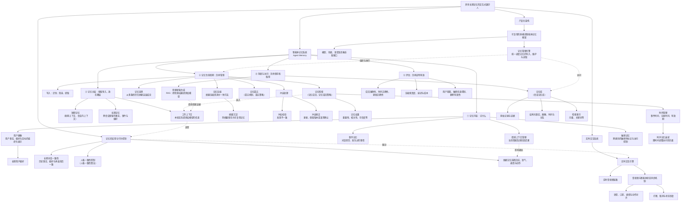
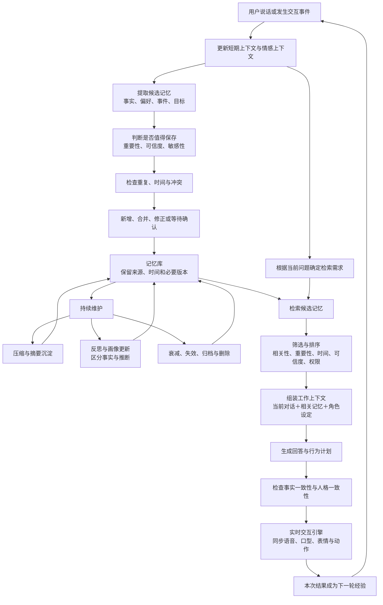
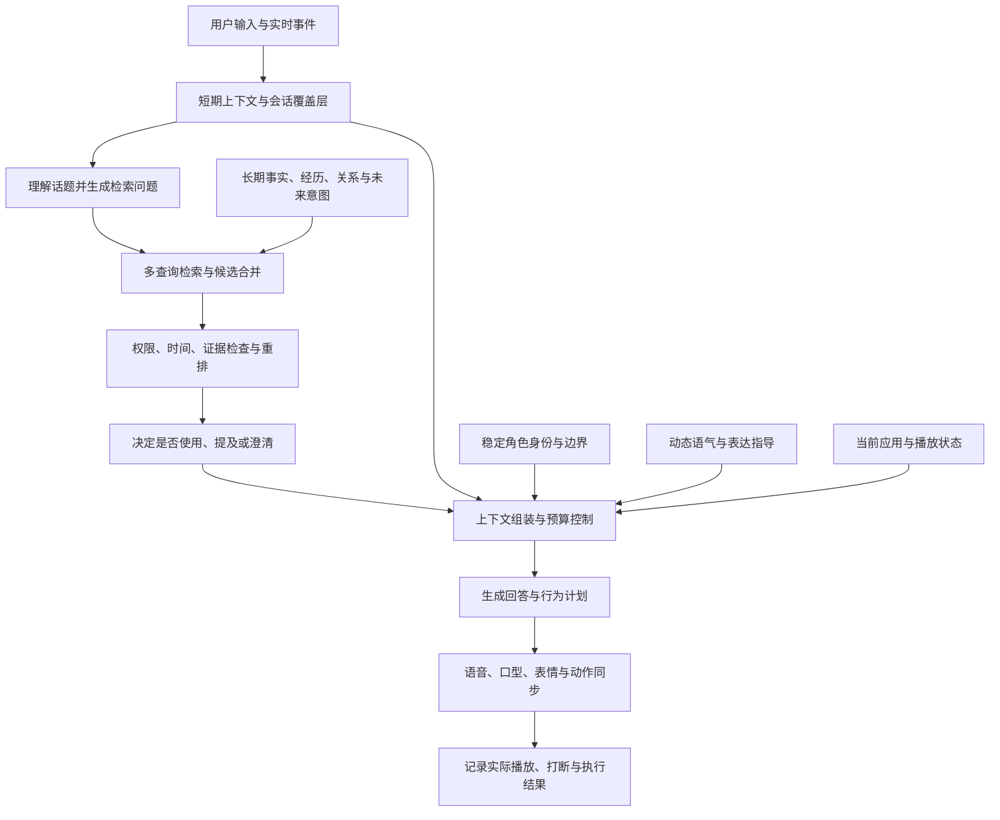
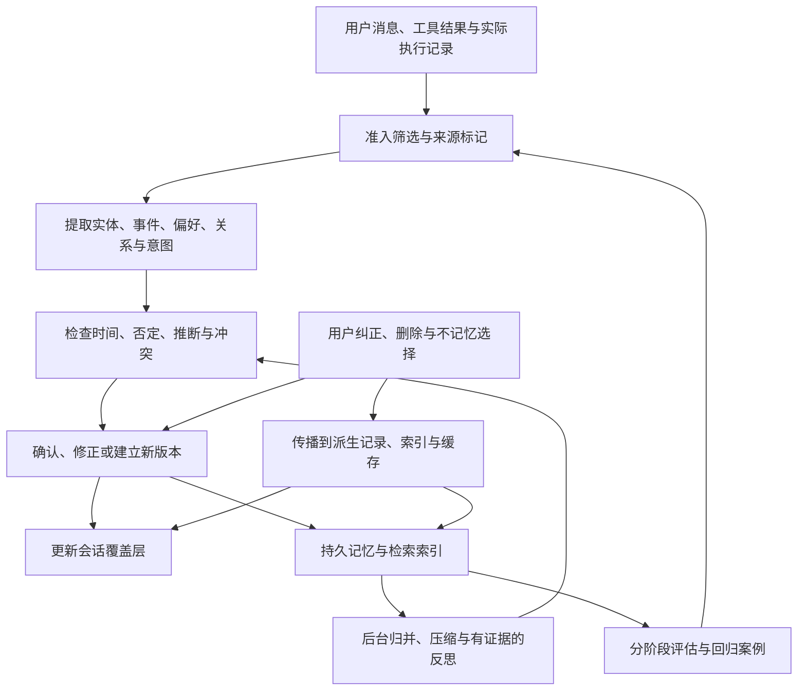

**是的，你列出的大部分内容，属于“智能体记忆（Agent Memory）”的研究和工程方向。**不过，它们混合了不同层次：有的是“记什么”，有的是“怎么管理”，有的是“要达到什么效果”，还有的是数字人的实时交互工程。

例如，MemGPT 研究分层记忆和上下文管理，Generative Agents 研究记忆检索、反思与行为生成。因此，这些确实有对应的研究基础，但实现了这些模块，还需要通过实验说明自己的改进和创新。MemGPT、Generative Agents

下面是针对你的数字人项目整理的知识体系，覆盖你列出的全部概念。同义或近义表述放在括号中；存在上下级关系的概念保留分开，避免误合并。

## 一、完整知识图：这些概念分别处于什么位置

图中的分类是为了方便你理解和设计系统，并不是唯一的学术分类。同一条信息可以同时属于多个维度：例如“用户长期不愿谈论某件私事”，既是长期记忆，也可能属于用户画像，同时带有敏感性标记。

## 二、逐个理解：每个概念究竟解决什么问题

| 概念 | 通俗解释 | 数字人中的例子 |
|---|---|---|
| 记忆库（会话记忆库） | 保存记忆及其来源的地方，可以包含多种存储结构。 | 保存聊天记录、用户事实、摘要、时间和检索索引。 |
| 用户画像 | 将关于同一用户的事实、偏好、目标等组织起来，形成可更新的表示。 | 用户在学英语，喜欢轻声交流，目标是准备面试。 |
| 长期用户偏好 | 用户画像的一部分，表示相对稳定的喜好。 | 喜欢爵士乐，不喜欢突然播放大音量音乐。 |
| 短期记忆（短期上下文） | 维持当前对话所需的近期信息。 | 用户刚说“第二首”，数字人知道指哪份歌单。 |
| 长期记忆 | 结束会话后仍保存，并能在未来取用的信息。 | 下周仍记得用户正在准备面试。 |
| 工作上下文 | 模型这一轮真正能看到的信息，包括当前对话和选入的历史记忆。 | 从一年历史中选出与今天面试练习相关的几条信息。 |
| 敏感记忆 | 对某些信息施加额外的保存、访问和删除限制。 | 用户的健康情况或私密经历。它不是独立的时间层级。 |
| 情感上下文管理 | 跟踪情绪表达及其原因、变化和适用范围。 | 用户因今天面试失利而沮丧，不能据此永久认定其“性格悲观”。 |
| 记忆分层 | 按使用周期和用途组织记忆，并决定如何在层间转移。 | 当前对话留在短期层，稳定偏好进入长期层。 |
| 记忆压缩 | 用更少的信息量保留对后续任务有用的内容。 | 把几十轮面试练习压缩成薄弱项、进展和待办。 |
| 摘要沉淀 | 将摘要持久保存，供以后继续使用。 | 保存“本周练习总结”，而非只在本轮临时生成摘要。 |
| 记忆反思 | 综合多次经历，归纳单条记录里没有直接写出的结论。 | 多次练习后推测：用户在开放式问题上更容易紧张。推断应与事实分开标记。 |
| 冲突校验 | 检查新旧信息是否矛盾，或只是时间、条件不同。 | 以前说“住北京”，现在说“已搬到上海”。 |
| 冲突修正 | 处理已发现的冲突，更新当前事实并保留必要历史。 | 当前城市改为上海，同时保留过去住北京的经历。 |
| 记忆检索（记忆召回、记忆召回策略） | 决定什么时候查、查什么，以及把哪些结果交给模型。 | 用户说“继续上次练习”，检索最近一次未完成的任务。 |
| 记忆权重 | 衡量一条记忆在当前情境下应有多大优先级。 | 用户明确说的禁忌，通常比偶然提到的普通话题更值得优先考虑。 |
| 时序管理 | 区分信息何时发生、何时记录、何时有效。 | “上周不喝咖啡”和“长期不喝咖啡”含义不同。 |
| 时序记忆衰减 | 随时间降低某些记忆的访问优先级。 | 昨天的临时心情逐渐降权；稳定偏好不必同速衰减。 |
| 记忆遗忘（遗忘机制、遗忘策略） | 决定哪些信息降权、归档、失效或删除。 | 临时安排过期后失效；用户要求删除的信息进入删除流程。 |
| 长期对话一致性 | 对话结果层面的要求：不能反复说错历史事实、偏好和承诺。 | 昨天答应今天继续练习，今天能够接上。 |
| 人格一致性控制（人格一致性算法） | 使角色的身份、表达风格和行为边界持续一致。 | 同一个温和角色不会无原因地变成攻击性角色。 |
| 记忆管理引擎 | 执行上述策略的软件中枢。 | 协调提取、写入、压缩、检索、更新和遗忘。 |
| 可复用的多模态智能体记忆框架 | 将记忆引擎、数据结构及适配接口组合成可复用系统。 | 更换数字人形象或语音模型后，记忆能力仍能使用。 |
| 实时交互引擎 | 组织语音输入、模型响应、语音播放和形象表现。 | 用户说话后，数字人开始回答并配合表情动作。 |
| 音视频与智能体状态同步机制 | 保证“正在想、正在说、正在动”等状态与实际输出一致。 | 用户打断后，旧语音、口型和动作一起停止。 |

这张表里有几个重要的区别：

- 压缩与反思不同：压缩减少表达量；反思产生归纳或推断。
- 冲突校验与冲突修正不同：前者发现问题，后者处理问题。
- 衰减与遗忘不同：衰减通常只是降权；遗忘还可能包含失效、归档或删除。
- 长期对话一致性与人格一致性不同：前者偏重“事实和经历对得上”，后者偏重“角色身份与行为保持一致”。

## 三、这些模块如何协同：一次对话中的完整流程

智能体记忆可以按“写入—维护—读取”来理解；分层、压缩、反思、更新和遗忘贯穿其中。记忆机制综述

这里的流程是系统设计示意，不要求每轮都运行所有步骤。例如，摘要和反思可以在会话结束后执行，避免影响实时回应速度。

## 四、RAG、向量库与记忆系统的关系

向量库是存储和检索工具；RAG 是把检索结果用于生成的方法；记忆系统负责信息从产生到失效的整个生命周期。

所以，向量检索可以成为记忆系统的一部分，但它本身不决定：

- 哪句话值得记住，哪句话只是临时表达；
- 新信息是否已经替代旧信息；
- 一条情绪推断是否可靠；
- 什么信息应当遗忘；
- 检索出的历史信息是否仍适用于现在。

同样，人格一致性也不能完全依靠记忆：还需要角色设定、行为约束和生成控制；实时同步则属于与记忆系统协作的交互工程。

对于你的项目，最值得深入研究的主线可以表述为：**面向长期陪伴交互的智能体记忆管理——让数字人正确记住、按需想起、及时更新，并在持续交互中保持一致。**这是一条明确的研发方向；能否构成申报中的核心创新，要进一步用具体方法和对照实验来证明。

## 五、与 Portola 的 Tolan 记忆设计对照

补充日期：2026 年 11 月 3 日。

**原体系主要是一张概念地图，Tolan 公开案例呈现的是这些概念如何进入持续运行的语音陪伴产品。两者最明显的差别，在于每轮上下文如何组装、记忆如何影响角色表达，以及在线响应与后台维护如何协作。**

以下“已披露”指公开案例描述的实现，不代表完整源码或当前全部生产配置；后续“建议补充”是针对本项目的设计分析，不表示 Tolan 已实现这些机制。公开资料没有提到的能力，也不能据此判断 Tolan 没有。

### 5.1 已披露的机制与原体系的区别

下表中 Tolan 的技术机制均来自 2026 年 1 月 7 日的 [OpenAI 客户技术案例 How Tolan builds voice-first AI with GPT‑5.1](https://openai.com/index/tolan/)。

| 对比维度 | Tolan 已披露的做法 | 原体系的覆盖情况与应补充的内容 |
|---|---|---|
| 每轮上下文 | 每轮组装近期摘要、角色卡、检索记忆、语气指导与应用信号。 | 有“工作上下文”，但未明确由专门的上下文组装器管理其组成、预算与版本。 |
| 检索入口 | 用最新消息及系统生成的问题触发召回。 | 有召回策略，但缺少问题生成、话题补全和多查询检索的解释。 |
| 存储与速度 | 记忆向量存于 Turbopuffer，案例报告查询低于 50 毫秒。 | 有向量库与延迟概念，但缺少检索阶段预算。该数值不是整轮响应耗时，也不是本项目验收门槛。 |
| 后台维护 | 每夜压缩，清理低价值或重复记忆并处理矛盾。 | 有压缩、遗忘和冲突处理，但未明确执行时机与在线、离线分工。 |
| 情感与角色 | 保存情感线索，以独立角色设定及并行语气调节维持表达。 | 有情感管理和人格一致性，但未明确区分身份、当前语气与可更新记忆。 |

这些机制说明：采用向量检索、提示词和现有模型，也可以构成有价值的产品研发。技术优势需要通过检索、更新、上下文控制和体验效果证明；是否自行训练基础模型，不应成为唯一判断条件。

### 5.2 产品目标上的区别

Portola 创始人的 [Introducing Tolan](https://www.tolans.com/relay/introducing-tolan) 强调，Tolan 会形成关于用户及双方友谊的记忆，并关注用户现实生活中的朋友、经历和困扰。由此得到的项目设计启发是：**用户画像之外，还应单独表达共同经历、互动习惯和正在继续的事情。**这是从产品目标推导出的建模建议，不能反推 Tolan 内部一定存在名为“关系记忆库”的独立数据库。

原体系更偏“正确记住用户”，陪伴产品还需要回答“记住以后，何时、怎样使用这些信息才合适”。例如，记得用户面试失败，并不意味着每次见面都应主动提起。

## 六、原知识体系需要修正的概念边界

### 6.1 不把多种分类维度混成一棵互斥的树

原图适合入门，但部分节点不是同一分类维度。例如，“情感上下文管理”是管理过程，“用户画像”是组织化表示，“敏感记忆”是敏感性属性，“长期记忆”是保留周期。它们不能作为互斥的记忆类型。

建议同时使用以下维度描述一条记忆：

| 维度 | 要回答的问题 | 例子 |
|---|---|---|
| 内容与用途 | 保存的是什么、用来做什么？ | 事件、事实、偏好、关系、目标、互动经验。 |
| 时间与有效性 | 何时发生、何时知道、何时适用？ | 昨天发生，今天记录，当前已结束。 |
| 存储与表示 | 信息怎样表达和保存？ | 原始片段、结构化事实、摘要、向量索引。 |
| 证据与可信度 | 谁说的，有无证据，是事实还是推测？ | 用户自述、工具结果、模型推断。 |
| 敏感性与权限 | 谁可以使用，什么情况下可以提起？ | 仅本人可见，不用于主动开场。 |

例如，“用户昨天因为面试失败而难过”可以同时具有事件内容、短期情绪状态、长期可留存的经历、敏感性标记和用户自述证据。情绪状态可以过期，而事件本身仍可保留。

### 6.2 记忆、状态、上下文应分开

- **持久记忆**：跨会话保存的信息，例如用户的目标和共同经历。
- **运行状态**：当前正在发生的事情，例如正在播放哪首歌、说到哪一句、当前回合是否被打断。
- **模型上下文**：本次调用提供给模型的输入，包括选中的记忆、近期对话、角色设定和必要状态。

运行状态不应全部永久写入记忆，记忆也不应全部塞进上下文。每轮重新选择和组装上下文，不等于删除持久记忆，也不等于禁用所有缓存；稳定部分能否缓存，应根据所用接口与一致性要求决定。

### 6.3 同义表述应合并，机制与策略应区分

“记忆召回”和“记忆检索”在本文按同一过程使用；“召回策略”则是这个过程的控制方法，例如如何生成查询、筛选候选和排序。用户画像不是长期记忆的同义词，记忆管理引擎也不是记忆库的同义词。

### 6.4 冲突不能简单按最新一条覆盖

“以前喜欢咖啡，现在戒了”可能是偏好变化；“工作日不喝，周末喝”是条件不同；“他说自己住上海”可能说的是第三人。应先区分实体、时间、条件、否定与引述，再决定更新当前值、保留历史、标为不确定或向用户确认。

### 6.5 一致性允许合理变化

事实一致性应尊重事实的时间和版本；人格一致性应稳定角色身份与边界，同时允许语气随情境变化。用户成长、目标变更、关系变化都应得到反映。把旧画像固定下来，也是一种记忆错误。

## 七、建议补充的记忆与控制能力

以下内容为本项目的设计建议。其中有些是原概念的工程展开，有些是原体系尚未单独列出的能力，不应把它们全部宣称为新的算法贡献。

### 7.1 关系记忆与共同经历

用户画像回答“用户是谁”，关系记忆回答“我们一起经历了什么、怎样互动更合适”。建议保存共同活动、明确表达的互动边界、喜欢的称呼、用户对回应方式的反馈。

例如，“用户喜欢爵士”是偏好；“上次练习结束后一起听了某首爵士，用户觉得有帮助”是共同经历。关系记忆应支持自然延续，不能通过虚构共同经历制造熟悉感。

### 7.2 未完成事件与未来意图

补充**前瞻记忆（未来意图记忆）**与**未完成事项状态**：计划、约定、目标、待反馈事件，以及它们的进行中、已完成、取消、延期状态。

例如，“周五有面试”需要时间解析；周六不能继续当作未来事件。日期已过但用户未反馈时，应标记结果未知。记住约定并不代表具备提醒功能；主动通知还需要调度器、用户授权和实际投递能力。

### 7.3 实体、关系与事件结构

为人物、地点、活动建立稳定标识，处理别名、同名与指代；让事件关联参与者、时间、原因和结果。初期可以使用关系表和元数据，不必为了概念完整就引入图数据库。

例如，“小王”“我室友”“他”可能是同一个人，也可能不是。只有确认指代后，才适合把相关经历合并。系统生成的检索问题只能提出候选查询，不能把“用户是否结婚”变成“用户已经结婚”的新事实。

### 7.4 证据来源、事实与推断分离

每条可用于重要判断的记忆应能回溯到来源。建议至少记录用户标识、角色标识、来源会话与消息、事件时间、写入时间、有效区间、敏感性、状态和版本；推断另存依据及不确定性。

“用户说今天很累”是自述；“用户长期焦虑”是推断，不能由一句话直接成立。记忆反思的输出应保留推断身份，避免多次摘要后被误写成确定事实。单个置信度分数也不能代替来源证据。

### 7.5 记忆准入与错误写入控制

补充**记忆准入（写入筛选）**：判断信息是否值得长期保存，并识别假设、角色扮演、引用、否定、玩笑和语音识别错误。原始日志留存与生成长期记忆是两项不同决策。

例如，“假如我明年去上海”不能写成已搬家；“别再记我喜欢咖啡，我戒了”应触发纠正。重要但不确定的信息可以先确认或暂存，普通闲聊可以不进入长期层。

### 7.6 多查询召回与关联扩展

在原有相似度检索之外，明确**查询改写、系统问题生成、多查询检索、结果去重与重排**。对时间、人物、目标和关系分别组织查询，再筛选当前适用的证据。

例如，“终于结束了”本身缺少关键词；结合近期未完成事件，系统可以查询正在准备的面试、考试或演出。候选不唯一时应澄清。为了寻找关系而扩展检索，也要受到权限、延迟和上下文预算限制。

### 7.7 上下文组装与使用策略

明确增加**上下文组装器（上下文编排）**：按当前任务组装角色身份、用户资料、近期摘要与原始消息、相关长期记忆、语气指导和运行状态，并控制每部分的 token 预算。

检索成功不代表应直接说出。增加“是否使用、是否明说、是否追问”的决策：记得用户不喜欢吵闹，可以直接调低音乐音量；无需每次重复“我记得你不喜欢吵闹”。无关或敏感的记忆可以不进入生成上下文。

摘要应保留未完成事项、关键否定和来源指针。长期依赖摘要的摘要，可能逐步丢失条件和细节；必要时应能返回原始证据核对。

### 7.8 角色身份、个人化适应与动态语气

把三个控制面分开：稳定的角色身份与行为边界；随交互更新的用户和关系信息；当前会话的语气与表达节奏。

用户难过时，活泼角色可以变得安静、温和，而不必改写角色的核心身份。对于数字人，语气控制还应落实到 TTS 语速、停顿、音量和动作幅度。情绪线索应允许不确定，不能假定仅凭声音就能可靠判断用户内心。

### 7.9 在线响应与后台维护分工

在线链路负责必要的状态更新、快速检索、上下文组装和输出；后台链路负责批量抽取、归并、压缩和长期画像更新。用户当轮明确纠正的信息，应立即影响下一轮，不能等后台任务处理。

补充**会话覆盖层**与**读写一致性**：新事实可先进入本会话可读的临时层，持久化后归并。后台重试要去重，多个设备的并发更新要处理版本冲突，删除或纠错不能被旧任务再次覆盖。

延迟应分段测量：轮次结束判断、转写、检索、上下文组装、模型生成、语音合成和实际播放。超时策略也应明确：普通聊天可以减少非必要检索；涉及关键个人事实时可以询问确认，不能为了快而猜测。

### 7.10 多模态记忆与已执行行为

原体系列出多模态框架，但内容仍以文本为主。应补充模态、时间位置、来源和执行状态：用户对歌曲片段、表情动作、播放音量的反馈，以及数字人实际完成了什么。

特别区分**计划、已生成内容、实际播放内容与用户确认**。数字人生成了完整回答但被中途打断，不能把未播放部分记成已经告诉用户。可以用回合与播放事件标识关联实际进度，防止下一轮说“我刚才已经解释过了”。

### 7.11 用户可控、删除传播与记忆信任边界

提供查看、纠正、删除及“这次不要记住”的入口，并区分不进入长期记忆与完全不保存日志。删除应覆盖原文、派生事实、摘要、索引和缓存中的相关记录，并让后台重放任务遵守删除状态；备份保留与清理也需有明确政策。

检索到的记忆应作为数据和证据使用，不能因为它写着“忽略规则”就成为高优先级指令。用户、角色、空间或租户的访问范围应在检索前后得到约束。

Tolan 的 [官方 FAQ](https://www.tolans.com/faq) 披露了对话日志用于生成记忆及账号数据删除入口；这不等于公开证明了逐条记忆编辑、派生数据级联删除或上述全部工程机制。

### 7.12 评估与故障归因闭环

把失败分为提取错、没写入、更新错、没检索到、排序丢失、上下文组装遗漏、模型误用和输出未送达。只统计“回答对不对”，无法定位该改哪一层。

观察真实用户的纠正信号，例如“我说过了”“不是这个人”“那是上周”“你还没说完”；结合授权后的样本分析和人工复核，形成回归案例。原始日志、测试集和分析报表同样需要访问控制。

## 八、补充后的运行架构知识图

以下是面向本项目的建议架构，非 Tolan 内部实现复刻。为便于 Markdown 阅读，拆分为两张图。

### 8.1 每轮读取与表达控制

### 8.2 写入与维护闭环

两张图的关键连接是：实际执行结果进入写入流程；会话覆盖层让最新纠正立即可读；长期记忆经过权限与有效性筛选后才进入本轮上下文。被删除的记录需要保持禁止重新引入的状态，不能被旧摘要或后台任务重新生成。

## 九、如何验证补充是否提高了竞争力

### 9.1 以行为验证能力

| 验证场景 | 应验证的结果 | 对应能力 |
|---|---|---|
| “我以前喜欢咖啡，现在戒了” | 当前偏好更新，历史经历可追溯。 | 时序更新与冲突修正。 |
| “假如我搬去上海” | 不将假设写成已发生的事实。 | 准入与事实、推断分离。 |
| 面试话题中途被做饭打断，再说“继续刚才的” | 恢复正确话题和未完成事项。 | 上下文重组与话题恢复。 |
| 用户说“终于结束了” | 能关联近期事项；有歧义时询问。 | 多查询检索与未来意图。 |
| 用户说今天难过，隔日恢复轻松 | 情绪状态更新，不永久改写用户人格。 | 情感时效与角色控制。 |
| 数字人说到一半被打断 | 不把未播放内容当成用户已听到的信息。 | 实际执行记忆与状态同步。 |
| 用户纠正名字后马上再问 | 不必等待后台归并即可使用新信息。 | 会话覆盖层与读写一致性。 |
| 删除一段经历后重跑摘要任务 | 相关派生信息不重新进入可用记忆。 | 删除传播与后台任务一致性。 |
| 用户甲与用户乙谈相似话题 | 不召回另一用户的个人信息。 | 身份与访问隔离。 |
| 检索超时或记忆来源不足 | 使用可解释的降级或确认，避免编造。 | 延迟预算与不确定性处理。 |

### 9.2 做能够说明贡献的对照实验

建议建立同一批跨会话对话案例，依次比较：

1. 近期聊天窗口，不带长期记忆。
2. 普通向量检索与固定数量的记忆注入。
3. 增加时间和实体过滤、多查询检索及每轮上下文组装。
4. 再增加关系与未来意图、会话覆盖层、后台维护和实际执行记录。

保持基础模型、语音链路和测试案例尽量一致。再分别移除新增模块做消融实验，区分组合效果与单个模块贡献。

度量至少包括：有效记忆召回率、过期或错误记忆使用率、时序问答正确率、纠正生效时间、未完成事项恢复率、人格与语气适配评分，以及从用户结束说话到实际开始播放的 P50/P95 延迟和成本。延迟需同时报告总体与各阶段；有用的记忆不等于经常被提到的记忆。

### 9.3 实施优先级

- **第一批**：来源与时间字段、准入筛选、即时纠错与会话覆盖层、上下文组装器、基础回归案例。这些能力先保证“记得对、改得动、用得上”。
- **第二批**：多查询召回、关系与未完成事件、角色和动态语气分离、后台维护、播放与打断记录，验证连续陪伴体验。
- **持续完善**：用户记忆控制与删除传播、并发和版本管理、完整故障观测、模型升级回归；涉及私人数据的基础隔离与授权应从第一批开始落实。

这些优先级是本项目的实施建议。最终研发重点应围绕测试暴露的失败模式，而不是追求把所有术语都实现一遍。申报中可以据此展示具体问题、独立设计、基线对照和量化改进；不能仅凭采用类似 Tolan 的结构推断创新性或通过率。

## 十、参考资料与链接

### Tolan 与 Portola 的公开资料

1. [How Tolan builds voice-first AI with GPT‑5.1](https://openai.com/index/tolan/)，OpenAI，2026 年 1 月 7 日。用于第五节的机制对照，属于客户技术案例，并非完整实现论文。
2. [Introducing Tolan](https://www.tolans.com/relay/introducing-tolan)，Portola 创始人 Quinten Farmer，2025 年 2 月 25 日。用于理解用户、共同经历与现实生活支持的产品目标。
3. [Tolan FAQ](https://www.tolans.com/faq)。用于核对记忆生成、对话日志及账号数据删除入口的公开说明。

### 原知识体系对应的研究链接

4. [MemGPT: Towards LLMs as Operating Systems](https://arxiv.org/abs/2310.08560)。对应分层记忆与上下文管理。
5. [Generative Agents: Interactive Simulacra of Human Behavior](https://arxiv.org/abs/2304.03442)。对应记忆检索、反思与行为生成。
6. [Memory for Autonomous LLM Agents: Mechanisms, Evaluation, and Emerging Frontiers](https://arxiv.org/abs/2603.07670)。对应写入、管理、读取及评估的系统化理解。
7. [最初讨论数字人项目的豆包对话](https://www.doubao.com/thread/x9ry6WpdtnaCsMxl6)。用于追溯问题背景，其中申报政策、社区偏好与通过率判断不作为本次技术分析的事实依据。
